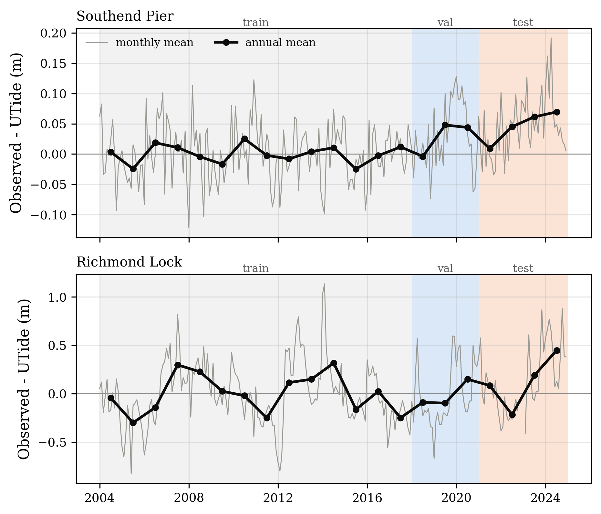
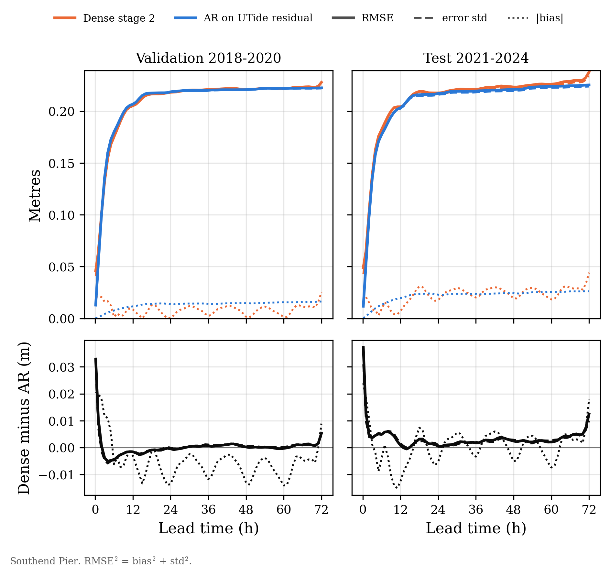
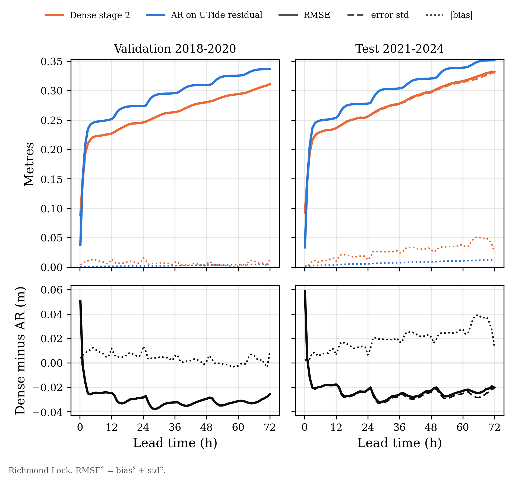
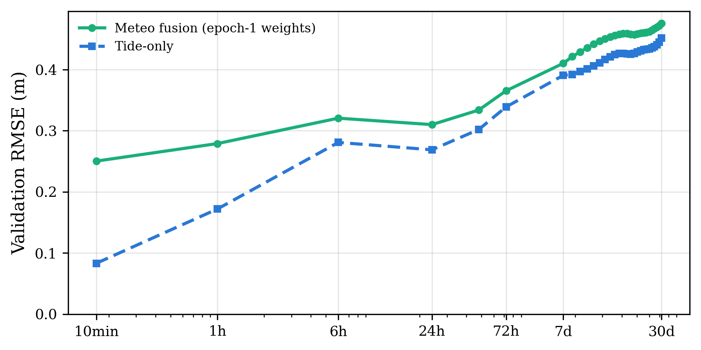
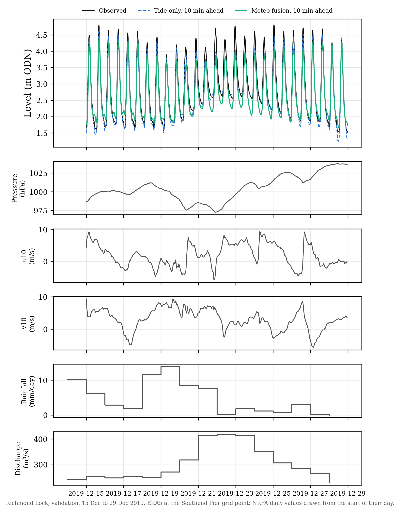

# 01 Diagnostics: bias decomposition and stage 3 at Richmond

Date: 2026-11-09 to 10. Branch `paper/nov-fixes`. Nothing was trained.
Scripts: `models/diag_bias_decomposition.py` (A), `models/diag_stage3_richmond.py` (B).
Tables: `outputs/diagnostics_2026-11/` (file names below). Figures: `figures/`.

**Test exposure.** Diagnostic A reports test-period numbers for the harmonic baseline, dense stage 2 and the AR residual baseline. Test results for all three were already published (`outputs/[richmond/]dense/dense_metrics.csv`, `outputs/[richmond/]baselines/baseline_metrics.csv`). Diagnostic B uses validation only. The timezone check in B uses the whole record, but it scores no model. All of this is recorded in `CHANGELOG.md`.

Conventions: error e = forecast - observed; bias = mean(e); std = population standard deviation of e; RMSE² = bias² + std². Flagged or missing targets are excluded, with the same masks as the published scoring. UTide residual = observed - UTide. "Harmonic baseline" is the train-only UTide fit (2004 to 2017).

---

## Diagnostic A: bias decomposition

### Inputs and checks
- Harmonic baseline: the train-only reconstruction already cached on the 10-min grid by `utils/models/baselines.py`. It is the same fit as the neural pipeline uses, so nothing was refitted.
- Dense stage 2: the saved per-anchor predictions, `dense_{val,test}_predictions_stage2.npz`.
- AR residual baseline (`ar_residual` in `best_configs.json`): Southend uses AR(4320), Yule-Walker, about 30 days of history. Richmond uses AR(26000), about 180 days.
  - Test predictions are saved by `eval_baselines.py`; validation predictions were not.
  - The validation predictions were regenerated through `eval_baselines`' own code path from the frozen config. This is the deterministic Yule-Walker estimate on train that `eval_baselines` repeats on every run, with no search.
  - Check: regenerating every 25th test anchor reproduces the saved test predictions to 1.2e-7 m (Southend) and 2.4e-7 m (Richmond).
  - The regenerated validation predictions are saved as `outputs/diagnostics_2026-11/<gauge>_ar_residual_val_predictions.npz`.

### A1. Harmonic baseline over the whole record

*Figure A1. Monthly (grey) and annual (black) mean of observed minus UTide, 2004 to 2024. Shading: train, validation, test.*

| Gauge | Split | Bias (m) | Std (m) | RMSE (m) | Mean residual (m) |
|---|---|---|---|---|---|
| Southend | train | 0.0000 | 0.2391 | 0.2391 | 0.000 |
| Southend | val | -0.0293 | 0.2345 | 0.2363 | +0.029 |
| Southend | test | -0.0463 | 0.2424 | 0.2468 | +0.046 |
| Richmond | train | 0.0000 | 0.5210 | 0.5210 | 0.000 |
| Richmond | val | 0.0112 | 0.5024 | 0.5025 | -0.011 |
| Richmond | test | -0.1420 | 0.5404 | 0.5587 | +0.142 |

Per calendar year: `A_utide_bias_by_split_and_year.csv`. Monthly means: `A_utide_monthly_mean_residual.csv`.

- Southend, annual mean residual: every training year lies within ±0.025 m. Later years are 2018 -0.004, 2019 +0.048, 2020 +0.044, 2021 +0.009, 2022 +0.045, 2023 +0.061, 2024 +0.070 m.
- Richmond, annual mean residual: -0.30 to +0.32 m in training years, -0.10 to +0.15 m in validation years, and -0.22 to +0.45 m in test years (2024: +0.449 m).

### A2. Dense stage 2 vs AR residual, per lead

*Figure A2a. Southend Pier. Top: RMSE (solid), error std (dashed), |bias| (dotted) against lead. Bottom: dense stage 2 minus AR for each.*

*Figure A2b. Richmond Lock, as A2a.*

All 73 leads, both models, both periods: `A_bias_std_rmse_by_lead.csv`. The 72h breakdown: `A_72h_gap_decomposition.csv`.

**Southend at 72h** (validation / test):

| | Dense stage 2 | AR residual |
|---|---|---|
| RMSE (m) | 0.2279 / 0.2378 | 0.2225 / 0.2253 |
| Bias (m) | -0.0252 / -0.0442 | -0.0163 / -0.0262 |
| Std (m) | 0.2265 / 0.2337 | 0.2219 / 0.2238 |

- 72h gap: 0.0053 m on validation, 0.0125 m on test.
- Share of the gap in MSE explained by the **global bias**: 15% on validation, 22% on test.
- Share explained by a **calendar-month offset** (an offset that is constant within each month but can change between months): 55% on validation, 33% on test.

**The dense model has a spike at its last lead.** Dense stage 2 RMSE at Southend:

| Lead | 70h | 71h | 72h |
|---|---|---|---|
| Validation | 0.2231 | 0.2241 | 0.2279 |
| Test | 0.2300 | 0.2327 | 0.2378 |

The bias jumps at the same lead. On validation it is -0.0003 m at 24h, -0.0017 m at 48h and -0.0252 m at 72h. The spike appears at both gauges and in both periods.

Averaged over leads 24 to 71h, the Southend gap almost disappears: dense 0.2215 vs AR 0.2211 m (validation), and 0.2242 vs 0.2215 m (test).

**Richmond:** dense stage 2 beats AR at 72h: 0.3111 vs 0.3367 m (validation) and 0.3316 vs 0.3517 m (test). Averaged over 24 to 71h: 0.2797 vs 0.3120 m (validation) and 0.2982 vs 0.3232 m (test). There is no gap for bias to explain.

**Short leads, Southend:** dense stage 2 has a positive 10-min bias of +0.021 m (validation) and +0.024 m (test), against an error std of 0.041 / 0.043 m. Bias therefore makes up 21% and 24% of its 10-min MSE. The AR bias at 10 min is below 0.001 m.

### A3. Discussion
- **How much of the Southend 72h gap is bias?** Roughly a fifth if the bias is treated as one constant (15% validation, 22% test). Between a third and a half if it is allowed to change month by month (33% to 55%). So a slowly varying offset is part of the story, but most of the gap is something else.
- **What the rest is.** Mostly the dense model's final-lead artefact. The stage 2 decoder sequence ends exactly at 72h with no padding points after it; the stage 3 decoder has three. Its 72h output is visibly worse than its 71h output, in both RMSE and bias. Away from that lead (24 to 71h) the dense model and AR differ by only 0.0004 m (validation) and 0.0027 m (test). On test, a monthly offset accounts for most of that small remaining gap (80%).
- **Is the harmonic residual drifting?**
  - At Southend, yes. The annual mean residual stays within ±0.025 m through the training years, then rises to +0.045 to +0.070 m in 2022 to 2024. That is consistent with mean sea-level rise, plus interannual anomalies, after the 2004 to 2017 fit. It is a few centimetres: small against an RMSE of about 0.23 m, but systematic.
  - At Richmond, the residual swings by ±0.3 to 0.45 m from year to year with river flow (wet 2014 and 2024 high, dry years low). There is no monotonic trend, and any drift is hidden by that variability.
- **The 16h vs 30-day explanation, revised.** The longer history is not what makes AR better at Southend. On validation the two are level from 24 to 71h. The 72h difference is mainly the dense model's edge effect, which a skip-connection fix aimed at short leads would not address. Padding the stage 2 decoder past 72h, as stage 3 already does, is a candidate one-change experiment.
- **Short-lead bias.** The 10-min bias at Southend (+2 cm) is relevant to item (c). Part of the short-lead problem is a systematic offset, not only noise.

---

## Diagnostic B: stage 3 at Richmond (validation only)

### Checks
- The validation scoring reproduces each model's best training validation loss: meteo fusion 0.08981 (epoch 1 of 11), tide-only 0.07639 (epoch 7 of 17). The source is `outputs/richmond/stage3_outputs/stage3_history.json`, and the check is in `B_audit.json`.
- The existing checkpoints were scored with the river alignment they were trained with (calendar day; see B2).
- On validation, the meteo-fusion model's 10-min RMSE is 0.250 m, against 0.083 m for the tide-only model. So the problem is not specific to the test period.

### B1. Branch ablation at inference
Each input is replaced by its training-set mean in the scaled units the model sees (0 for standardised channels, 1 for the availability flags). RMSE is in metres. Source: `B_ablation_val_rmse.csv`.

| Model | Input replaced by its mean | 10min | 1h | 6h | 24h | 72h |
|---|---|---|---|---|---|---|
| meteo fusion | none (unablated) | 0.2503 | 0.2790 | 0.3205 | 0.3100 | 0.3653 |
| meteo fusion | tide history | 0.6570 | 0.6443 | 0.5445 | 0.6037 | 0.6395 |
| meteo fusion | UTide decoder | 1.0158 | 1.2053 | 1.5014 | 1.3347 | 1.3906 |
| meteo fusion | pressure | 0.2522 | 0.2838 | 0.3228 | 0.3149 | 0.3770 |
| meteo fusion | wind u10 | 0.2517 | 0.2811 | 0.3226 | 0.3117 | 0.3684 |
| meteo fusion | wind v10 | 0.2553 | 0.2879 | 0.3286 | 0.3097 | 0.3659 |
| meteo fusion | all meteo | 0.2628 | 0.2956 | 0.3330 | 0.3165 | 0.3769 |
| meteo fusion | rainfall | 0.2684 | 0.2943 | 0.3351 | 0.3293 | 0.3838 |
| meteo fusion | discharge | 0.3078 | 0.3465 | 0.3934 | 0.3819 | 0.4246 |
| meteo fusion | river availability flags | 0.2503 | 0.2790 | 0.3205 | 0.3100 | 0.3653 |
| meteo fusion | all river | 0.3329 | 0.3681 | 0.4047 | 0.3827 | 0.4129 |
| meteo fusion | none, river leak removed (33h lag) | 0.2537 | 0.2826 | 0.3206 | 0.3185 | 0.3762 |
| tide-only | none (unablated) | 0.0833 | 0.1720 | 0.2809 | 0.2688 | 0.3390 |
| tide-only | tide history | 1.3167 | 1.1638 | 0.7134 | 0.9842 | 0.8543 |
| tide-only | UTide decoder | 0.2111 | 0.5692 | 1.5380 | 1.2260 | 1.4187 |

*Figure B2. Validation RMSE at all 30 trained leads, meteo fusion vs tide-only, Richmond.*

### B2. Input audit

| Check | Finding |
|---|---|
| Scalers | Every covariate uses a z-score fitted on Richmond's own training windows (2004 to 2017, every third window). The values stored in the checkpoint match a fresh recomputation exactly, and differ from Southend's: for example, tide mean 1.40 vs 0.15 m, discharge mean 59.1 vs 51.8 m³/s. Nothing is reused from Southend. The two availability flags are left unscaled (0/1). `B_scalers.csv`. |
| ERA5 point | Only one ERA5 point was consolidated, the grid cell nearest Southend Pier (51.5145 N, 0.7238 E). That is the 0.25° cell at about 51.50 N, 0.75 E. Richmond (51.463 N, 0.3175 W) uses the same point (`config.GAUGES['richmond']['meteo_site']`), about 72 km east of the gauge. Richmond's own cell (about 51.50 N, 0.25 W) was never downloaded. |
| Timezone | No timezone handling anywhere in the code; timestamps are naive. ERA5 is UTC. NRFA daily values are dated in GMT water days. Empirical test on the gauges: for each calendar month, the lag (−2h to +2h in 10-min steps) that best aligns observed level with UTide is **0 min in every month at both gauges** (`B_timezone_lag_by_month.csv`). Had the gauge clock followed BST, the summer months would show a 60-min lag. So the gauge record is consistently in UTC/GMT, aligned with UTide. |
| ERA5 to 10-min | An anchor at time t uses the hourly values up to and including the hour at or before t, with no future values. |
| NRFA daily to 10-min | Every anchor on calendar day D used the value dated D for the whole day, and the previous 29 days, as a 30-step daily sequence. Nothing is interpolated or forward-filled onto the 10-min grid. **Leak:** NRFA gauged daily flow is the mean over the 09:00 to 09:00 GMT water day, dated by its start ([NRFA](https://nrfa.ceh.ac.uk/gauged-daily-flow-data)). So the value dated D includes flow up to 09:00 on D+1: up to 33h of future discharge. I couldn't confirm the day convention for catchment daily rainfall, which may also be a 09:00 water day. **Fixed** in commit `46b998b` (see B3). |
| Missingness | Gauge rows absent from the 10-min grid: 1.7% train, 0.1% validation, 6.5% test. Gauge flagged: 0.57%, 0.15%, 0.19%. ERA5: none missing in any split. Rainfall filled with train-month climatology: 0% train, 0% validation, **25% of test days** (record ends 2023-12-31). Discharge filled: 0%, 0%, **6.3% of test days** (record ends 2024-09-30). `B_missingness.csv`. |
| Availability flags | The flags are 1 everywhere in train and validation, so the model never saw a 0. Replacing them changes nothing on validation. On test, the 2024 climatology-filled days feed the model a value it has never seen. |
| Covariate shift | Validation means in scaled units are within 0.12 standard deviations of train for every channel (largest: u10 at -0.12), and the 99th percentiles are similar. `B_covariate_shift_scaled.csv`. |
| Hyperparameters | Meteo fusion: lr 1.78e-3, weight decay 1e-5, batch 512. Tide-only: lr 2.02e-3, weight decay 0, batch 512. Both were **reused from Southend's search winners** (`REUSE_HPARAMS_FROM = 'southend'` in `train_stage3.py`), not searched at Richmond. Architecture: encoder hidden size 64 (tide), 64 (meteo), 32 (river); decoder BiLSTM hidden size 64; attention sizes 64/64/32; lookbacks 16h tide, 120h meteo, 30 days river. At most 60 epochs, early stopping patience 10. |

*Figure B1. Richmond, 15 to 29 Dec 2019 (validation; the two weeks around the highest validation discharge, 22 Dec). Top: observed level and the 10-min-ahead forecasts of both models. Below: the raw covariates.*

### B3. Diagnosis, most likely first

1. **Overfitting plus early stopping left an epoch-1 model (most likely; the evidence is consistent).**
   - Validation loss is lowest after the first epoch (0.0898) and rises to about 0.12 by epoch 11.
   - Over the same epochs, training loss falls from 0.125 to 0.034, about half of the tide-only model's final 0.0695. The covariate branches let the model fit the training years much better without generalising.
   - The saved checkpoint is therefore the epoch-1 model, which has not yet learned to follow the latest observation, the skill that makes short leads accurate. In Figure B1, its 10-min forecast misses low water by up to about 0.5 m during the December discharge peak and damps high waters, while the tide-only model sits on the observations.
   - The ablation fits this picture. At 10 min, the meteo-fusion model depends far more on the UTide decoder than on the recent gauge history: removing UTide gives 1.02 m, removing the history 0.66 m. The tide-only model is the other way round: removing UTide gives 0.21 m, removing the history 1.32 m.
   - The overall validation losses after epoch 1 are almost the same for both models (0.0898 vs 0.0909 for tide-only at its epoch 1). The tide-only model then kept improving to 0.0764.
   - Likely contributors, which can't be told apart without training:
     - Lr and weight decay were taken from Southend rather than searched at Richmond.
     - The 30-day daily river and 5-day hourly meteo sequences are nearly unique per day, and they repeat across the 48 training windows of each day, so they are easy to memorise.
   - Southend's meteo-fusion training history is not on disk, so the two gauges' curves can't be compared.
2. **No input is "broken".**
   - Each covariate, replaced by its mean, makes the model *worse*, never better. Discharge matters most (10 min 0.250 → 0.308 m; 72h 0.365 → 0.425 m), then rainfall, then the meteo channels (all meteo: 10 min 0.250 → 0.263 m).
   - A corrupted or misaligned input would typically show the opposite: removing it would help.
   - The scalers are correct and Richmond-specific, there is no timezone offset, there is no missing data in validation, and covariate shift is small.
3. **River future leak (a real bug, but not the cause).** It would flatter the model, not degrade it. Feeding the existing model leak-free river inputs (33h lag) costs 0.003 m at 10 min and 0.011 m at 72h (row "river leak removed"), so the model does use the future information a little. Fixed in `46b998b` with a unit test; no retraining.
4. **ERA5 at the Southend point for Richmond (a design choice, minor).** All meteo together moves 10-min RMSE by only 0.013 m. A Richmond-cell download would be more defensible, but it does not explain the 3.5x.
5. **Test-period availability flags (affects test only).** The model never saw flag = 0 in training, but 25% of test rainfall days and 6% of test discharge days are filled, mostly in 2024. This may hurt 2024 test numbers, and it should be handled before any stage 3 result is quoted for 2024.

### What a retrain would need (not done)
To be decided by Al for the overnight queue, as one change per variant:
- **A** retrain the Richmond meteo-fusion model with the leak fix only. This also needs the validation-scoring change in `train_stage3.py` first, per CLAUDE.md.
- **B** the same, plus its own Richmond hyperparameter search instead of Southend's.
- If both still stop at epoch 1, the next step is regularising or shrinking the covariate branches.
- `train_stage3.py` and `plot_stage3.py` now default to the leak-free alignment. Scoring the existing stage 3 checkpoints exactly needs `river_lag_hours=config.LEGACY_RIVER_LAG_HOURS`, as `diag_stage3_richmond.py` does.
