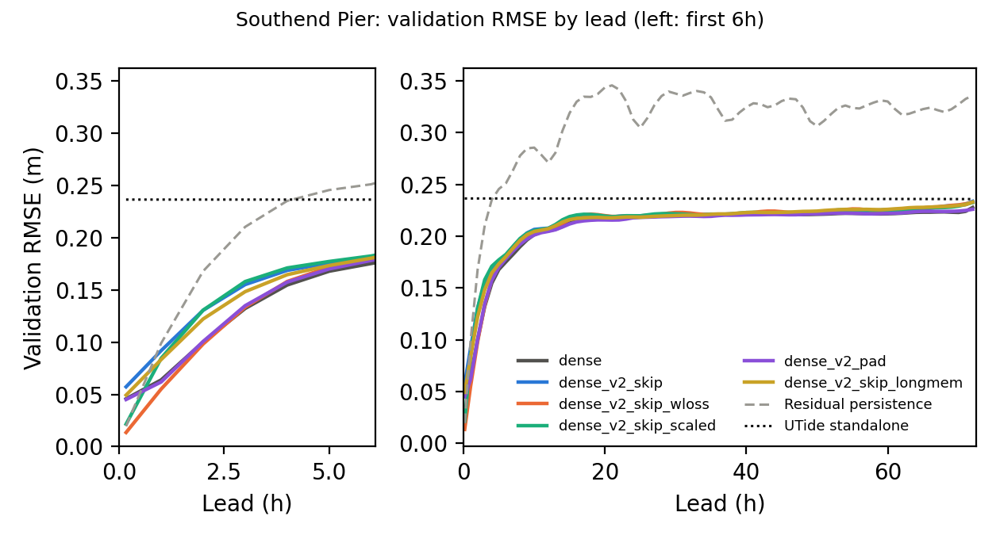
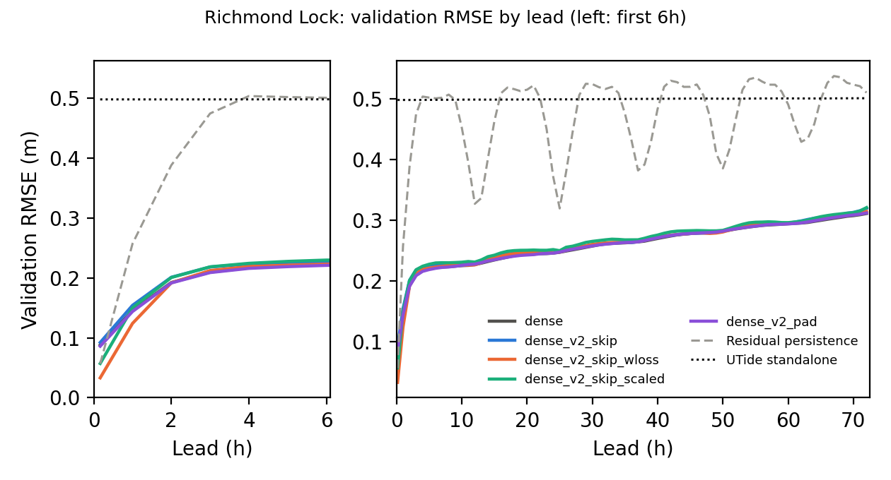
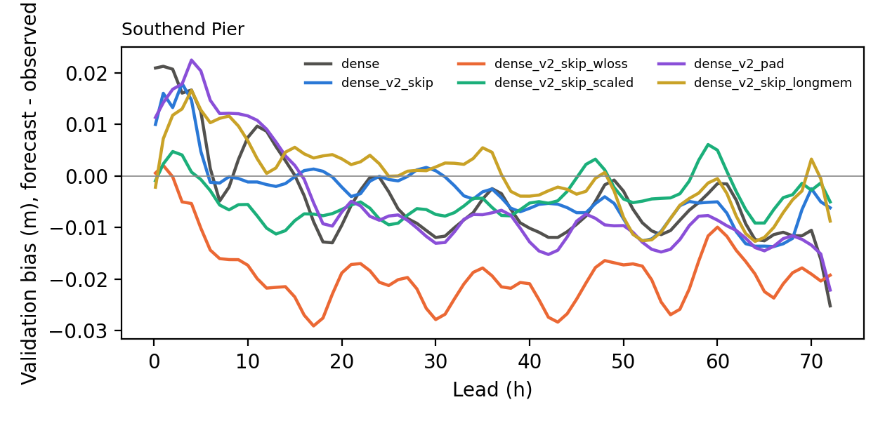
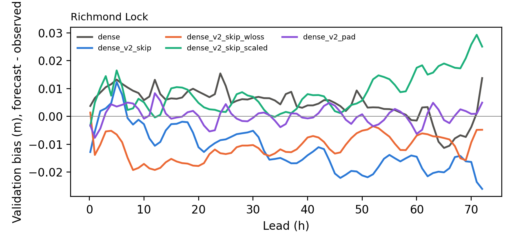

# Overnight results

Queue started 2026-11-10 00:41 from commit `75d73e2` on branch `paper/nov-fixes`. Report written 2026-11-10 15:13. Deadline 2026-11-10 17:00 GMT. Development decisions use validation only; test was scored only for the winner per gauge (see CHANGELOG).

## Step status

| step | status | start | end | minutes | note / log |
|---|---|---|---|---|---|
| 01_train_skip_wloss_southend | ok | 00:41 | 02:45 | 123.9 |  |
| 02_train_skip_scaled_southend | ok | 02:45 | 04:24 | 99.4 |  |
| 03_train_pad_southend | ok | 04:24 | 05:56 | 91.8 |  |
| 04_train_skip_wloss_richmond | ok | 05:56 | 07:23 | 87.6 |  |
| 05_train_skip_scaled_richmond | ok | 07:23 | 09:11 | 107.3 |  |
| 06_train_pad_richmond | ok | 09:11 | 10:31 | 79.8 |  |
| 07_train_skip_southend | ok | 10:31 | 11:55 | 84.8 |  |
| 08_select_southend | ok | 11:55 | 11:56 | 0.3 |  |
| 08_select_richmond | ok | 11:56 | 11:56 | 0.3 |  |
| 08_testscore_winner_southend | ok | 11:56 | 11:58 | 2.3 | test-scored winner dense_v2_skip_wloss |
| 08_testscore_winner_richmond | ok | 11:58 | 12:00 | 2.0 | test-scored winner dense_v2_skip_wloss |
| 09_baselines_vs_winner_southend | ok | 12:00 | 12:01 | 0.8 |  |
| 09_baselines_vs_winner_richmond | ok | 12:01 | 12:02 | 0.8 |  |
| 10_postprocess_southend_val | ok | 12:02 | 12:02 | 0.5 |  |
| 10_postprocess_southend_test | ok | 12:02 | 12:03 | 0.8 |  |
| 10_postprocess_richmond_val | ok | 12:03 | 12:04 | 1.0 |  |
| 10_postprocess_richmond_test | ok | 12:04 | 12:05 | 1.3 |  |
| 11_optional_train_skip_richmond | ok | 12:05 | 13:31 | 85.8 |  |
| 11_optional_train_skip_longmem_southend | ok | 13:31 | 15:13 | 101.6 |  |
| 12_report_commit_push | running | 15:13 |  |  |  |

## Selection (validation)

Rule (pre-registered, amended 2026-11-10): mean over the 73 leads of validation RMSE divided by min(residual persistence, UTide) RMSE at that lead; lowest wins.

- richmond: did not finish: dense_v2_skip

| gauge | candidate | score | winner |
|---|---|---|---|
| southend | dense_v2_skip_wloss | 0.9084 | yes |
| southend | dense_v2_pad | 0.9204 |  |
| southend | dense | 0.9213 |  |
| southend | dense_v2_skip_scaled | 0.9245 |  |
| southend | dense_v2_skip | 0.9482 |  |
| richmond | dense_v2_skip_wloss | 0.5722 | yes |
| richmond | dense_v2_pad | 0.5834 |  |
| richmond | dense | 0.5834 |  |
| richmond | dense_v2_skip_scaled | 0.5882 |  |

## Validation RMSE by lead, every candidate (m)

### Southend Pier

| model | 10min | 1h | 6h | 24h | 48h | 72h | mean 73 |
|---|---|---|---|---|---|---|---|
| dense | 0.0458 | 0.0638 | 0.1754 | 0.2182 | 0.2210 | 0.2279 | 0.2088 |
| dense_v2_skip | 0.0573 | 0.0919 | 0.1819 | 0.2194 | 0.2227 | 0.2338 | 0.2127 |
| dense_v2_skip_wloss | 0.0135 | 0.0551 | 0.1796 | 0.2196 | 0.2226 | 0.2328 | 0.2108 |
| dense_v2_skip_scaled | 0.0215 | 0.0846 | 0.1826 | 0.2198 | 0.2231 | 0.2326 | 0.2126 |
| dense_v2_pad | 0.0451 | 0.0619 | 0.1783 | 0.2179 | 0.2212 | 0.2261 | 0.2087 |
| dense_v2_skip_longmem | 0.0493 | 0.0833 | 0.1804 | 0.2187 | 0.2240 | 0.2331 | 0.2123 |
| Residual persistence | 0.0197 | 0.0989 | 0.2512 | 0.3128 | 0.3243 | 0.3360 | 0.3071 |
| UTide standalone | 0.2365 | 0.2365 | 0.2365 | 0.2365 | 0.2362 | 0.2360 | 0.2363 |

### Richmond Lock

| model | 10min | 1h | 6h | 24h | 48h | 72h | mean 73 |
|---|---|---|---|---|---|---|---|
| dense | 0.0880 | 0.1454 | 0.2226 | 0.2459 | 0.2802 | 0.3111 | 0.2601 |
| dense_v2_skip | 0.0922 | 0.1543 | 0.2275 | 0.2470 | 0.2792 | 0.3198 | 0.2630 |
| dense_v2_skip_wloss | 0.0332 | 0.1241 | 0.2230 | 0.2466 | 0.2783 | 0.3145 | 0.2606 |
| dense_v2_skip_scaled | 0.0572 | 0.1500 | 0.2298 | 0.2518 | 0.2826 | 0.3209 | 0.2654 |
| dense_v2_pad | 0.0860 | 0.1439 | 0.2210 | 0.2459 | 0.2798 | 0.3120 | 0.2603 |
| Residual persistence | 0.0568 | 0.2572 | 0.5007 | 0.3722 | 0.4709 | 0.5100 | 0.4692 |
| UTide standalone | 0.4980 | 0.4980 | 0.4982 | 0.4990 | 0.5002 | 0.5008 | 0.4995 |

## Validation bias by lead (m)

### Southend Pier

| model | 10min | 1h | 6h | 24h | 48h | 72h |
|---|---|---|---|---|---|---|
| dense | 0.0209 | 0.0213 | 0.0015 | -0.0003 | -0.0017 | -0.0252 |
| dense_v2_skip | 0.0100 | 0.0160 | -0.0012 | -0.0001 | -0.0040 | -0.0062 |
| dense_v2_skip_wloss | 0.0005 | 0.0020 | -0.0144 | -0.0206 | -0.0164 | -0.0193 |
| dense_v2_skip_scaled | -0.0009 | 0.0023 | -0.0028 | -0.0083 | 0.0012 | -0.0050 |
| dense_v2_pad | 0.0113 | 0.0142 | 0.0147 | -0.0086 | -0.0095 | -0.0221 |
| dense_v2_skip_longmem | -0.0022 | 0.0072 | 0.0103 | 0.0024 | 0.0007 | -0.0088 |

### Richmond Lock

| model | 10min | 1h | 6h | 24h | 48h | 72h |
|---|---|---|---|---|---|---|
| dense | 0.0037 | 0.0066 | 0.0117 | 0.0154 | 0.0040 | 0.0138 |
| dense_v2_skip | -0.0128 | -0.0054 | 0.0078 | -0.0085 | -0.0196 | -0.0260 |
| dense_v2_skip_wloss | 0.0014 | -0.0138 | -0.0093 | -0.0132 | -0.0078 | -0.0048 |
| dense_v2_skip_scaled | -0.0033 | 0.0049 | 0.0108 | 0.0017 | 0.0041 | 0.0250 |
| dense_v2_pad | -0.0032 | -0.0077 | 0.0041 | 0.0011 | -0.0027 | 0.0049 |

## TEST RMSE of the winner per gauge (m)

### Southend Pier: winner `dense_v2_skip_wloss`

| model | 10min | 1h | 6h | 24h | 48h | 72h | mean 73 |
|---|---|---|---|---|---|---|---|
| dense_v2_skip_wloss | 0.0129 | 0.0550 | 0.1833 | 0.2220 | 0.2252 | 0.2412 | 0.2146 |
| Residual persistence | 0.0197 | 0.1027 | 0.2712 | 0.3075 | 0.3254 | 0.3455 | 0.3122 |
| UTide standalone | 0.2446 | 0.2446 | 0.2443 | 0.2436 | 0.2439 | 0.2453 | 0.2442 |
| old dense (published) | 0.0491 | 0.0645 | 0.1823 | 0.2176 | 0.2233 | 0.2378 | 0.2116 |

### Richmond Lock: winner `dense_v2_skip_wloss`

| model | 10min | 1h | 6h | 24h | 48h | 72h | mean 73 |
|---|---|---|---|---|---|---|---|
| dense_v2_skip_wloss | 0.0308 | 0.1290 | 0.2421 | 0.2598 | 0.2977 | 0.3347 | 0.2792 |
| Residual persistence | 0.0546 | 0.2601 | 0.5417 | 0.3770 | 0.4900 | 0.5404 | 0.4947 |
| UTide standalone | 0.5596 | 0.5597 | 0.5597 | 0.5599 | 0.5598 | 0.5597 | 0.5598 |
| old dense (published) | 0.0921 | 0.1468 | 0.2295 | 0.2561 | 0.2980 | 0.3316 | 0.2751 |

## Classical baselines vs the winner (test)

### Southend Pier (test, vs `dense_v2_skip_wloss`)

Joint tests: mean over leads of RMSE(baseline) - RMSE(dense), 95% block-bootstrap CI (> 0 favours dense):

| track | baseline | leads | n_leads | mean_rmse_diff_m | ci_low | ci_high | significant | favours | boot_reps |
|---|---|---|---|---|---|---|---|---|---|
| level | ridge_level | all 73 leads | 73 | 0.0002 | -0.0020 | 0.0025 | False | dense | 2000 |
| level | ridge_level | 24h to 72h | 49 | 0.0009 | -0.0016 | 0.0035 | False | dense | 2000 |
| residual | ar_residual | all 73 leads | 73 | -0.0066 | -0.0083 | -0.0049 | True | baseline | 2000 |
| residual | ar_residual | 24h to 72h | 49 | -0.0068 | -0.0086 | -0.0051 | True | baseline | 2000 |

RMSE at selected leads (m):

| model | 10min | 1h | 6h | 24h | 48h | 72h |
|---|---|---|---|---|---|---|
| Dense stage 2 (dense_v2_skip_wloss) | 0.0129 | 0.0550 | 0.1833 | 0.2220 | 0.2252 | 0.2412 |
| UTide standalone | 0.2446 | 0.2446 | 0.2443 | 0.2436 | 0.2439 | 0.2453 |
| ar_residual | 0.0118 | 0.0513 | 0.1774 | 0.2171 | 0.2209 | 0.2253 |
| ridge_level | 0.0112 | 0.0490 | 0.1802 | 0.2246 | 0.2285 | 0.2336 |

Full tables: `C:\Users\alfat\Documents\STA_MSc\Term_3\tidal_analysis_and_prediction\outputs\baselines_vs_dense_v2_skip_wloss`

### Richmond Lock (test, vs `dense_v2_skip_wloss`)

Joint tests: mean over leads of RMSE(baseline) - RMSE(dense), 95% block-bootstrap CI (> 0 favours dense):

| track | baseline | leads | n_leads | mean_rmse_diff_m | ci_low | ci_high | significant | favours | boot_reps |
|---|---|---|---|---|---|---|---|---|---|
| level | ridge_level | all 73 leads | 73 | 0.0270 | 0.0207 | 0.0331 | True | dense | 2000 |
| level | ridge_level | 24h to 72h | 49 | 0.0298 | 0.0224 | 0.0370 | True | dense | 2000 |
| residual | ar_residual | all 73 leads | 73 | 0.0183 | 0.0119 | 0.0246 | True | dense | 2000 |
| residual | ar_residual | 24h to 72h | 49 | 0.0218 | 0.0142 | 0.0292 | True | dense | 2000 |

RMSE at selected leads (m):

| model | 10min | 1h | 6h | 24h | 48h | 72h |
|---|---|---|---|---|---|---|
| Dense stage 2 (dense_v2_skip_wloss) | 0.0308 | 0.1290 | 0.2421 | 0.2598 | 0.2977 | 0.3347 |
| UTide standalone | 0.5596 | 0.5597 | 0.5597 | 0.5599 | 0.5598 | 0.5597 |
| ar_residual | 0.0333 | 0.1425 | 0.2493 | 0.2780 | 0.3207 | 0.3517 |
| ridge_level | 0.0857 | 0.1822 | 0.2575 | 0.2799 | 0.3278 | 0.3603 |

Full tables: `C:\Users\alfat\Documents\STA_MSc\Term_3\tidal_analysis_and_prediction\outputs\richmond\baselines_vs_dense_v2_skip_wloss`

## Interpolation to 10 min and high-water metric (winner)

### Southend Pier, `dense_v2_skip_wloss`, val

RMSE on the 10-min trajectory (m):

| model | 10 min | 20 min | 30 min | 40 min | 50 min | 60 min | 360 min | 1440 min | 4320 min |
|---|---|---|---|---|---|---|---|---|---|
| UTide alone | 0.2365 | 0.2365 | 0.2365 | 0.2365 | 0.2365 | 0.2365 | 0.2365 | 0.2365 | 0.2360 |
| dense, cubic interp | 0.0135 | 0.0221 | 0.0301 | 0.0384 | 0.0469 | 0.0551 | 0.1796 | 0.2196 | 0.2328 |
| dense, linear interp | 0.0135 | 0.0223 | 0.0311 | 0.0394 | 0.0472 | 0.0551 | 0.1796 | 0.2196 | 0.2328 |
| dense, native leads only | 0.0135 |  |  |  |  | 0.0551 | 0.1796 | 0.2196 | 0.2328 |

High/low water errors over 0-72h (height in m, timing in minutes):

| model | event | n_matches | height_bias_m | height_rmse_m | timing_mae_min | timing_bias_min | share_at_window_edge |
|---|---|---|---|---|---|---|---|
| UTide alone | high water | 139394 | -0.0759 | 0.2263 | 7.5226 | 0.9915 | 0.0000 |
| dense, native leads only | high water | 139394 | -0.0748 | 0.2043 | 15.3012 | -0.4222 | 0.0000 |
| dense, linear interp | high water | 139394 | -0.0452 | 0.1931 | 5.3897 | -0.0547 | 0.0000 |
| dense, cubic interp | high water | 139394 | -0.0402 | 0.1924 | 5.2373 | -0.2457 | 0.0000 |
| AR residual baseline (10-min) | high water | 139394 | -0.0301 | 0.1925 | 5.0595 | -0.2588 | 0.0000 |
| UTide alone | low water | 139253 | -0.0419 | 0.1986 | 10.9066 | -6.1316 | 0.0000 |
| dense, native leads only | low water | 139253 | 0.0132 | 0.1846 | 16.7769 | -1.5473 | 0.0000 |
| dense, linear interp | low water | 139253 | -0.0104 | 0.1835 | 8.2086 | -2.0691 | 0.0000 |
| dense, cubic interp | low water | 139253 | -0.0085 | 0.1835 | 7.8484 | -0.5871 | 0.0000 |
| AR residual baseline (10-min) | low water | 139253 | -0.0121 | 0.1814 | 8.0247 | -1.8308 | 0.0000 |

High waters per day 1.928; low waters scored: True (LW plateau median 50 min vs HW 40 min).

### Southend Pier, `dense_v2_skip_wloss`, test

RMSE on the 10-min trajectory (m):

| model | 10 min | 20 min | 30 min | 40 min | 50 min | 60 min | 360 min | 1440 min | 4320 min |
|---|---|---|---|---|---|---|---|---|---|
| UTide alone | 0.2446 | 0.2446 | 0.2446 | 0.2446 | 0.2446 | 0.2446 | 0.2443 | 0.2436 | 0.2453 |
| dense, cubic interp | 0.0129 | 0.0214 | 0.0295 | 0.0379 | 0.0465 | 0.0550 | 0.1833 | 0.2220 | 0.2412 |
| dense, linear interp | 0.0129 | 0.0214 | 0.0304 | 0.0388 | 0.0469 | 0.0550 | 0.1833 | 0.2220 | 0.2412 |
| dense, native leads only | 0.0129 |  |  |  |  | 0.0550 | 0.1833 | 0.2220 | 0.2412 |

High/low water errors over 0-72h (height in m, timing in minutes):

| model | event | n_matches | height_bias_m | height_rmse_m | timing_mae_min | timing_bias_min | share_at_window_edge |
|---|---|---|---|---|---|---|---|
| UTide alone | high water | 181538 | -0.1375 | 0.2510 | 7.8191 | 0.6577 | 0.0000 |
| dense, native leads only | high water | 181538 | -0.1141 | 0.2168 | 15.5965 | -0.2410 | 0.0000 |
| dense, linear interp | high water | 181538 | -0.0858 | 0.2009 | 5.8378 | 0.1476 | 0.0000 |
| dense, cubic interp | high water | 181538 | -0.0803 | 0.1987 | 5.5967 | -0.0036 | 0.0000 |
| AR residual baseline (10-min) | high water | 181538 | -0.0450 | 0.1858 | 5.4306 | -0.4862 | 0.0000 |
| UTide alone | low water | 181789 | -0.0263 | 0.2039 | 10.8434 | -4.9255 | 0.0000 |
| dense, native leads only | low water | 181789 | 0.0170 | 0.1914 | 16.9922 | -0.9064 | 0.0000 |
| dense, linear interp | low water | 181789 | -0.0057 | 0.1898 | 8.4889 | -1.2654 | 0.0000 |
| dense, cubic interp | low water | 181789 | -0.0039 | 0.1898 | 8.2214 | 0.1167 | 0.0000 |
| AR residual baseline (10-min) | low water | 181789 | -0.0189 | 0.1860 | 8.0045 | -1.2010 | 0.0000 |

High waters per day 1.925; low waters scored: True (LW plateau median 50 min vs HW 40 min).

### Richmond Lock, `dense_v2_skip_wloss`, val

RMSE on the 10-min trajectory (m):

| model | 10 min | 20 min | 30 min | 40 min | 50 min | 60 min | 360 min | 1440 min | 4320 min |
|---|---|---|---|---|---|---|---|---|---|
| UTide alone | 0.4980 | 0.4980 | 0.4980 | 0.4980 | 0.4980 | 0.4980 | 0.4982 | 0.4990 | 0.5008 |
| dense, cubic interp | 0.0332 | 0.0534 | 0.0725 | 0.0910 | 0.1081 | 0.1241 | 0.2230 | 0.2466 | 0.3145 |
| dense, linear interp | 0.0332 | 0.0589 | 0.0815 | 0.0977 | 0.1103 | 0.1241 | 0.2230 | 0.2466 | 0.3145 |
| dense, native leads only | 0.0332 |  |  |  |  | 0.1241 | 0.2230 | 0.2466 | 0.3145 |

High/low water errors over 0-72h (height in m, timing in minutes):

| model | event | n_matches | height_bias_m | height_rmse_m | timing_mae_min | timing_bias_min | share_at_window_edge |
|---|---|---|---|---|---|---|---|
| UTide alone | high water | 135694 | -0.1826 | 0.3583 | 12.8583 | 3.2566 | 0.0000 |
| dense, native leads only | high water | 135694 | -0.1201 | 0.2907 | 16.8296 | -0.0247 | 0.0000 |
| dense, linear interp | high water | 135694 | -0.0935 | 0.2733 | 10.1461 | -0.0089 | 0.0000 |
| dense, cubic interp | high water | 135694 | -0.0770 | 0.2662 | 8.6344 | 0.1596 | 0.0000 |
| AR residual baseline (10-min) | high water | 135694 | -0.0606 | 0.3003 | 8.5795 | 0.9666 | 0.0000 |

High waters per day 1.889; low waters scored: False (LW plateau median 60 min vs HW 30 min).

### Richmond Lock, `dense_v2_skip_wloss`, test

RMSE on the 10-min trajectory (m):

| model | 10 min | 20 min | 30 min | 40 min | 50 min | 60 min | 360 min | 1440 min | 4320 min |
|---|---|---|---|---|---|---|---|---|---|
| UTide alone | 0.5596 | 0.5597 | 0.5597 | 0.5597 | 0.5597 | 0.5597 | 0.5597 | 0.5599 | 0.5597 |
| dense, cubic interp | 0.0308 | 0.0515 | 0.0714 | 0.0912 | 0.1104 | 0.1290 | 0.2421 | 0.2598 | 0.3347 |
| dense, linear interp | 0.0308 | 0.0561 | 0.0791 | 0.0969 | 0.1120 | 0.1290 | 0.2421 | 0.2598 | 0.3347 |
| dense, native leads only | 0.0308 |  |  |  |  | 0.1290 | 0.2421 | 0.2598 | 0.3347 |

High/low water errors over 0-72h (height in m, timing in minutes):

| model | event | n_matches | height_bias_m | height_rmse_m | timing_mae_min | timing_bias_min | share_at_window_edge |
|---|---|---|---|---|---|---|---|
| UTide alone | high water | 170065 | -0.2641 | 0.4348 | 14.9918 | 8.6814 | 0.0000 |
| dense, native leads only | high water | 170065 | -0.1441 | 0.3139 | 17.8121 | 4.5289 | 0.0000 |
| dense, linear interp | high water | 170065 | -0.1170 | 0.2965 | 11.3898 | 4.4320 | 0.0000 |
| dense, cubic interp | high water | 170065 | -0.1023 | 0.2900 | 9.7871 | 4.3325 | 0.0000 |
| AR residual baseline (10-min) | high water | 170065 | -0.0543 | 0.3165 | 9.4610 | 1.7285 | 0.0000 |

High waters per day 1.778; low waters scored: False (LW plateau median 70 min vs HW 30 min).
