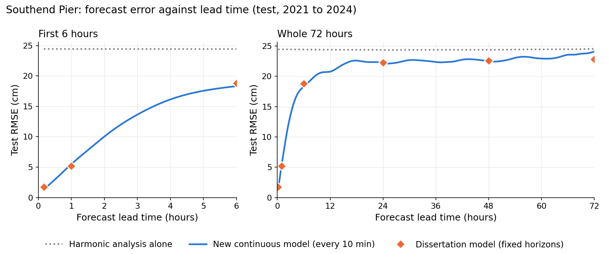
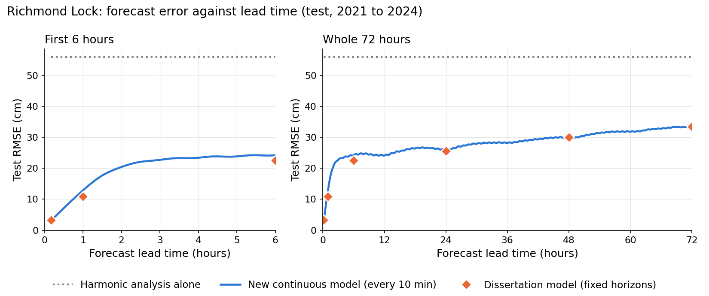
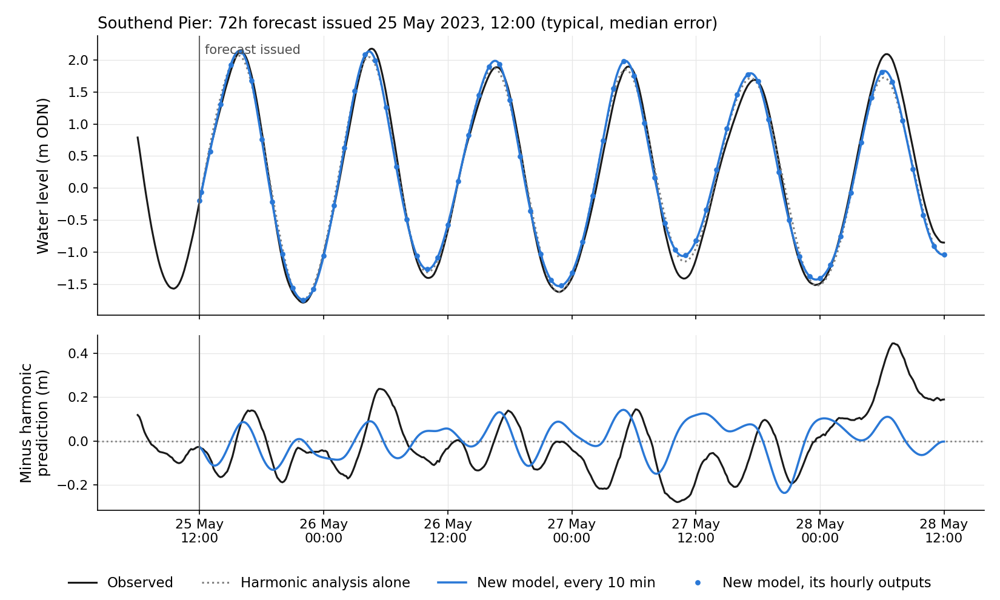
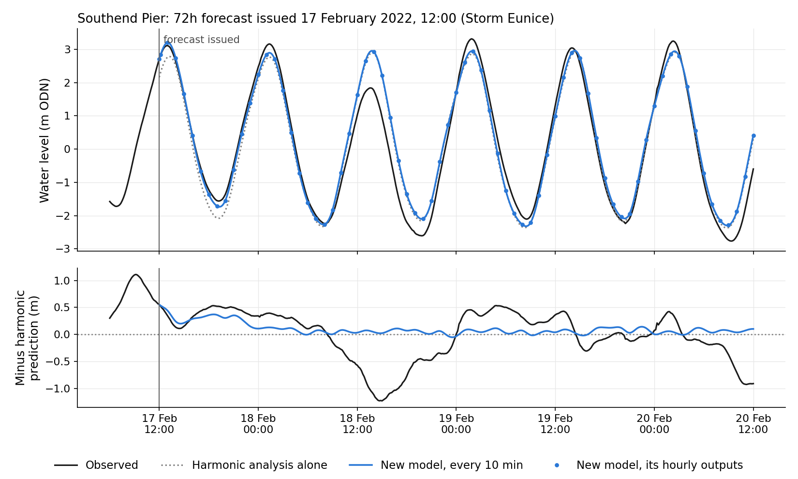
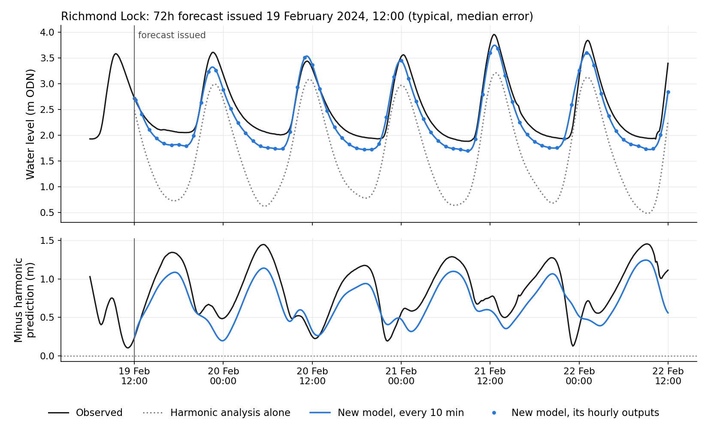
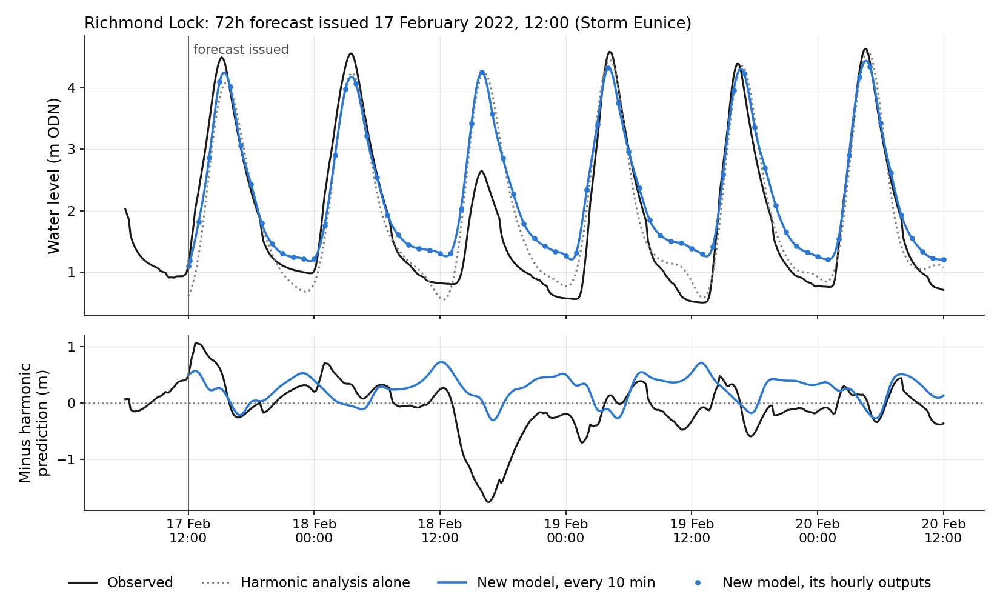

# Tidal Thames forecasting: neural model update, November 2026

RMSE is in cm throughout. Each table says which data it uses. **Validation** means 2018 to 2020, used for every development decision. **Test** means 2021 to 2024, scored once for the finished model. The harmonic analysis is fitted on 2004 to 2017 only.

## 1. Since the last meeting

Last time you saw a results table at a handful of fixed forecast horizons. This update adds a second gauge, Richmond Lock, and a single continuous forecast from 10 minutes to 72 hours.

## 2. Richmond Lock added

- **Where and why.** Richmond Lock is near the upstream tidal limit of the Thames, so the tide there is strongly shaped by river flow: low waters are raised in high flow and the tide is nonlinear. It is the hard case to set against Southend, where the tide is close to linear.
- **How hard, in one number.** Harmonic analysis alone has a test RMSE of 56.0 cm at Richmond, against 24.4 cm at Southend (averaged over the 73 lead times).
- **Record.** 1 January 2004 to 31 December 2024 at 10-minute spacing: 1,078,071 readings, in m ODN (the gauge's chart datum minus 0.61 m).
- **Cleaning** (`src/clean_richmond.py`):
  - **Faults removed:** spikes, stuck-sensor readings, a datum shift in August 2009, and out-of-range values.
  - **Short gaps** (6 hours or less) were patched with the harmonic prediction plus the residual interpolated across the gap, not the harmonic prediction alone, because river flow moves the low waters too far for a pure harmonic patch.
  - **Longer gaps** were left as gaps.
  - **Flagged values:** every patched value is flagged and never scored. That is 4,712 readings (0.44%).

## 3. Continuous forecast (0 to 72h)

### What the model does

The dissertation model gave seven separate forecasts, at 10 min, 1h, 6h, 24h, 48h, 72h and 168h. The new model produces one forecast of 73 values (10 min, then every hour to 72h) in a single pass. It uses the same inputs as before:
- the last 16 hours of observed water level;
- the harmonic prediction at the forecast times.

### From hourly to every 10 minutes

1. Take the model's correction to the harmonic prediction (forecast minus harmonic) at each hour.
2. Join those corrections with a smooth curve (a cubic spline).
3. Add back the harmonic prediction at every 10 minutes.

**Why this is valid:**
- The correction comes from surge and river effects, which change over hours, so a smooth curve between hourly values loses little.
- The fast tidal rise and fall, which a curve through hourly points would distort, comes entirely from the harmonic prediction, which is exact at every 10 minutes.

**Check (test, 30 minutes ahead, the point furthest from the hourly outputs):**

| Interpolation | Southend RMSE | Richmond RMSE |
|---|---|---|
| Cubic spline | 2.9 cm | 7.1 cm |
| Straight line | 3.0 cm | 7.9 cm |

### Two faults fixed, and how the winning version was chosen

**1. The neglected 10-minute lead.** The first continuous model was worse at 10 minutes than simply carrying forward the current surge ("persistence").
- **Cause:** training minimised the error summed over all 73 leads. Errors at 10 minutes are tiny, so that lead made up almost none of what the model was trying to reduce, and it was effectively ignored.
- **Fix, part 1:** the model now starts from persistence and learns only a correction to it.
- **Fix, part 2:** each lead's error is weighted by how hard that lead is for persistence. In ML terms, this is a reweighted loss function.

**2. The edge effect at 72h.** The model's last output step has no later context, so error jumps at the final lead.
- **Tried:** a version that runs three extra hourly steps past 72h, which are thrown away.

**Selection.** Five versions were compared on validation under a rule written down before any of them was trained: the lowest average, over the 73 leads, of each lead's RMSE divided by the better of persistence and harmonic analysis. The overnight queue finished every step. One candidate (Richmond, persistence correction without weighting) finished after the selection ran. It was scored afterwards on validation and does not change the winner.

**Selection score (validation, lower is better)**

| Version | Southend | Richmond |
|---|---|---|
| Correction to persistence + weighted loss (**winner at both**) | **0.908** | **0.572** |
| Three padding steps past 72h | 0.920 | 0.583 |
| First continuous model | 0.921 | 0.583 |
| Correction to persistence, scaled per lead | 0.925 | 0.588 |
| Correction to persistence, unweighted | 0.948 | 0.591 |

**Effect of the two fixes (validation RMSE, cm)**

| | Southend 10 min | Southend rise 71h to 72h | Richmond 10 min | Richmond rise 71h to 72h |
|---|---|---|---|---|
| Persistence (reference) | 1.97 | | 5.68 | |
| First continuous model | 4.58 | +0.38 | 8.80 | +0.20 |
| Three padding steps past 72h | 4.51 | +0.11 | 8.60 | +0.20 |
| **Winner** | **1.35** | +0.14 | **3.32** | +0.34 |

**What this shows:**
- The 10-minute fault is fixed at both gauges, and the winner now beats persistence.
- Padding reduced the 72h jump at Southend but not at Richmond. Padding is not in the winner, so the 72h jump remains.
- Combining the weighted loss with padding has not been trained yet.
- The winner gives up a little at the far end. At 72h on validation it is 23.3 against 22.8 cm (Southend) and 31.5 against 31.1 cm (Richmond), compared with the first continuous model.

### Error against lead time

*Test, 2021 to 2024. Blue: the winner, every 10 minutes, all test forecasts. Orange: the dissertation model at its fixed horizons, on the forecasts it shares with the new model (within 3% of the same set). Grey: harmonic analysis alone.*

### Example forecasts

Each figure shows one 72h forecast, issued at the vertical line. The lower panel is the same forecast minus the harmonic prediction, which makes the surge visible.
- **Typical forecasts** were chosen by rule, not by eye: of all forecasts issued at 12:00 in the test years, the one whose 72h error is the median.
- **The surge event** is Storm Eunice, the dissertation's example date.

**Southend Pier: typical, 25 May 2023, 12:00 (72h RMSE 15.5 cm)**

**Southend Pier: Storm Eunice, 17 February 2022, 12:00**

**Richmond Lock: typical, 19 February 2024, 12:00 (72h RMSE 21.6 cm)**

**Richmond Lock: Storm Eunice, 17 February 2022, 12:00**

**What to look for:**
- The first few hours follow the observations closely. After that, the forecast settles towards a steady offset from the harmonic prediction, because the model has no weather forecast.
- In the Richmond typical case (high river flow), low waters sit well above the harmonic prediction, and the model keeps them raised for the full 72 hours.
- Storm Eunice brought a negative surge (observed minus harmonic) of 1.23 m at Southend and 1.76 m at Richmond, about 27 hours after issue. No model here can anticipate that without a weather forecast.

### High and low waters

**Test, forecasts issued every hour, all high and low waters within 0 to 72h**

| | Height RMSE (cm) | Timing error, mean absolute (min) |
|---|---|---|
| **Southend, high water** | | |
| Harmonic analysis alone | 25.1 | 7.8 |
| New model, hourly values only | 21.7 | 15.6 |
| New model, every 10 min | **19.9** | **5.6** |
| **Southend, low water** | | |
| Harmonic analysis alone | 20.4 | 10.8 |
| New model, every 10 min | **19.0** | **8.2** |
| **Richmond, high water** | | |
| Harmonic analysis alone | 43.5 | 15.0 |
| New model, hourly values only | 31.4 | 17.8 |
| New model, every 10 min | **29.0** | **9.8** |

- The 10-minute output cuts the timing error by about half or more compared with the hourly values alone.
- Richmond low waters are not scored: they sit on a floor near -1.0 m ODN (only 0.05% of readings fall below -1.06 m), so their height and timing reflect that floor rather than the tide.
- Every method still under-predicts high water at Southend (mean -8.0 cm for the new model, -13.8 cm for harmonic analysis alone).

## 4. Results per gauge

Both tables are test data, on the forecasts that both neural models could issue: 199,319 forecasts at Southend and 192,318 at Richmond. Bold marks the lower of the two neural models.

**Southend Pier (test, RMSE cm)**

| | 10 min | 1h | 6h | 24h | 48h | 72h |
|---|---|---|---|---|---|---|
| Harmonic analysis alone | 24.5 | 24.5 | 24.5 | 24.4 | 24.4 | 24.4 |
| Dissertation model (fixed horizons) | 1.7 | **5.2** | 18.8 | **22.3** | 22.6 | **22.8** |
| New continuous model | **1.3** | 5.5 | **18.4** | **22.3** | **22.5** | 24.0 |

**Richmond Lock (test, RMSE cm)**

| | 10 min | 1h | 6h | 24h | 48h | 72h |
|---|---|---|---|---|---|---|
| Harmonic analysis alone | 56.1 | 56.1 | 56.1 | 56.1 | 56.1 | 56.1 |
| Dissertation model (fixed horizons) | 3.3 | **10.9** | **22.5** | **25.6** | 30.0 | 33.5 |
| New continuous model | **3.1** | 12.9 | 24.3 | 26.0 | **29.8** | 33.5 |

- **Southend.** The continuous model matches the fixed-horizon model from 6h to 48h and is better at 10 min. It is 1.1 cm worse at 72h, which is the remaining edge effect. Both cut the harmonic error from 24.5 cm to about 1 to 6 cm in the first hour, but by at most about 2 cm at one to three days.
- **Richmond.** Both neural models cut the harmonic error by about 40% at 72h (56.1 to 33.5 cm). The continuous model is behind the fixed-horizon model at 1h and 6h (by 2.1 and 1.7 cm), within 0.4 cm of it from 24h onwards, and better at 10 min.
- **The gain is the continuous 10-minute output, not extra accuracy.** Accuracy is similar to the dissertation model overall.

## 5. Things tested that did not help

**Harmonic analysis settings at Richmond** (harmonic analysis on its own, before any neural model). Tried:
- the automatic constituent selection (68 constituents, chosen by UTide's Rayleigh criterion) against the same set plus 22 shallow-water constituents (90 in all);
- ordinary least squares against three robust fitting methods.

| Settings (Richmond) | Validation RMSE | Test RMSE |
|---|---|---|
| Default: automatic selection, ordinary least squares | 50.3 | 55.9 |
| Best on validation: + 22 shallow-water constituents | 49.5 | 55.2 |
| Robust fitting (range over 6 versions, fitted at hourly spacing) | 50.3 to 51.9 | 58.3 to 60.1 |

- Robust fitting is worse because river-raised low waters are frequent and systematic, not outliers.
- The best setting gains 0.7 cm (1.2%), so the default was kept and existing results stay valid.

**Reduced resolution: fitting the harmonic analysis to hourly instead of 10-minute data.** No change. Default settings:

| | Validation, hourly fit | Validation, 10-min fit | Test, hourly fit | Test, 10-min fit |
|---|---|---|---|---|
| Richmond | 50.25 | 50.25 | 55.86 | 55.87 |
| Southend | 23.63 | 23.63 | 24.68 | 24.68 |

## 6. Fixes to the meteorological model

- **A future leak, now fixed.** The river discharge (and rainfall) inputs are daily values covering 09:00 to 09:00 and dated by their start. The dissertation's stage 3 model used each one from midnight of its date, which means up to 33h before the data would exist. They are now used only once available.
  - This flattered the dissertation's stage 3 results, and those results were still worse than the tide-only model. At 72h on test: Southend 24.5 against 22.7 cm, Richmond 41.2 against 36.5 cm.
  - Size of the leak at Richmond, validation: removing it adds 0.3 cm at 10 min and 1.1 cm at 72h.
- **Stage 3 at Richmond overfits.** Its best validation score came after one pass through the training data, and it got worse after that. It reused Southend's training settings and needs its own tuning.
- **Plan:** retrain stage 3 leak-free, scored on validation only, with settings tuned for Richmond, before adding any new meteorological data.

## 7. Simpler statistical models

- Classical linear forecasters can match or slightly beat the neural model at Southend, where the tide is close to linear.
- In those runs, however, they were given much more information: 30 to 180 days of the harmonic residual (observed minus harmonic prediction), against 16 hours of observed water level for the neural model.
- At Richmond the neural model stays ahead.
- A fair, information-matched comparison is a separate piece of work I would like to pursue after this paper.

## 8. How the neural model could be improved

These ideas come from the classical tests:
- **Forecast the residual directly.** Give the network the past residual instead of the raw water level, so it does not have to separate surge from tide itself within its 16 hours. At present it sees the harmonic prediction only at the forecast times, not over its history.
- **Add a linear head.** A simple linear layer runs straight from the inputs to the outputs, alongside the LSTM, which is the network's memory component. The linear part handles the mostly linear behaviour of the residual, which the classical results suggest is much of it. The LSTM then learns only what is left, such as the tide and river interaction at Richmond.
- **Simplify the architecture.** If much of the signal is linear, a smaller network may do as well and train faster.

## 9. Questions for you: meteorological data

- **River flow:** daily discharge arrives about 33h late. Is sub-daily river flow (for example at Kingston) worth sourcing before anything else?
- **Wind and pressure:** both gauges currently use one ERA5 point at Southend. Would a point (or field) over the southern North Sea be more useful?
- **Weather forecasts:** should the paper stay with observed history only, or is adding weather-forecast inputs in scope?

---

Sources (local, gitignored outputs, listed for traceability):
- **Selection and validation:** `outputs/[richmond/]<version>/dense_val_metrics.csv` and `reports/2026-11-nov-fixes/02_overnight_results.md`.
- **Test, per gauge:** `outputs/[richmond/]dense_v2_skip_wloss/dense_vs_sparse_matched.csv`.
- **10-minute and high-water results:** `.../postprocess/test_rmse_433_leads.csv` and `test_high_low_water.csv`.
- **Harmonic settings:** `outputs/<gauge>/utide_search/utide_option_search.csv`.
- **Stage 3:** `outputs/[richmond/]stage3_outputs/stage3_metrics.csv` and `outputs/diagnostics_2026-11/B_ablation_val_rmse.csv`.
- **Richmond record:** `Data/richmond_lock_data.csv`.
- **Figures:** `models/plot_supervisor_update.py`.
