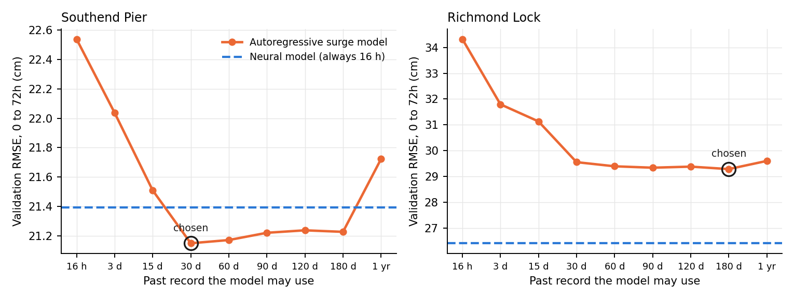
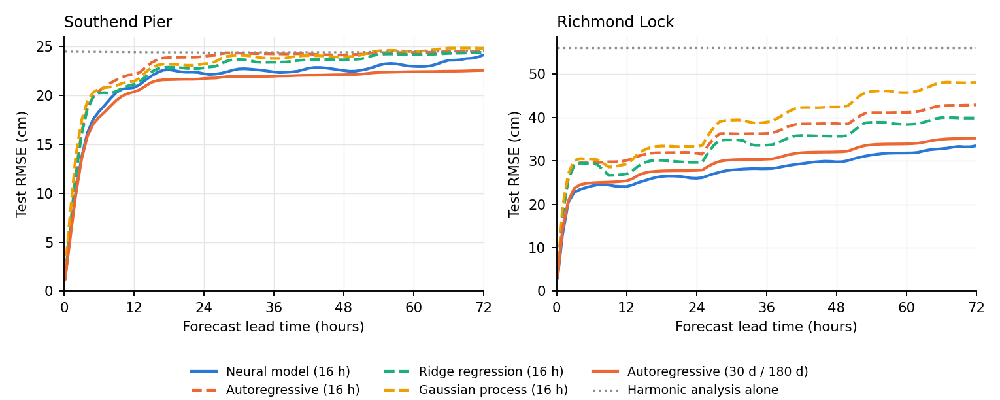
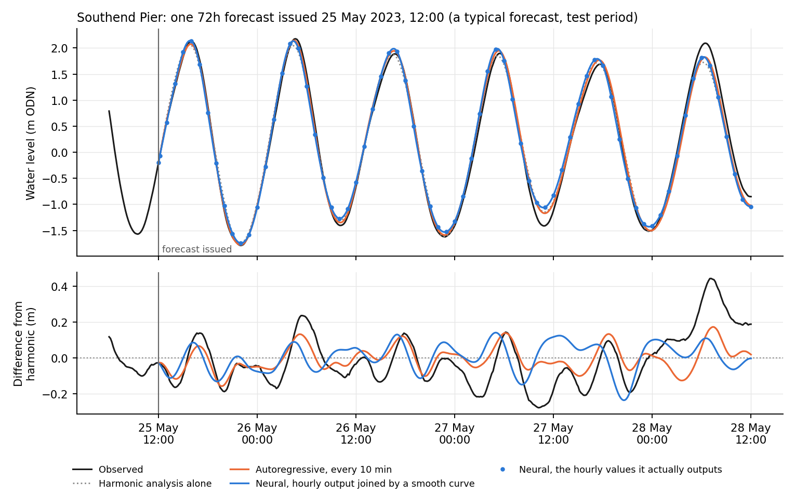
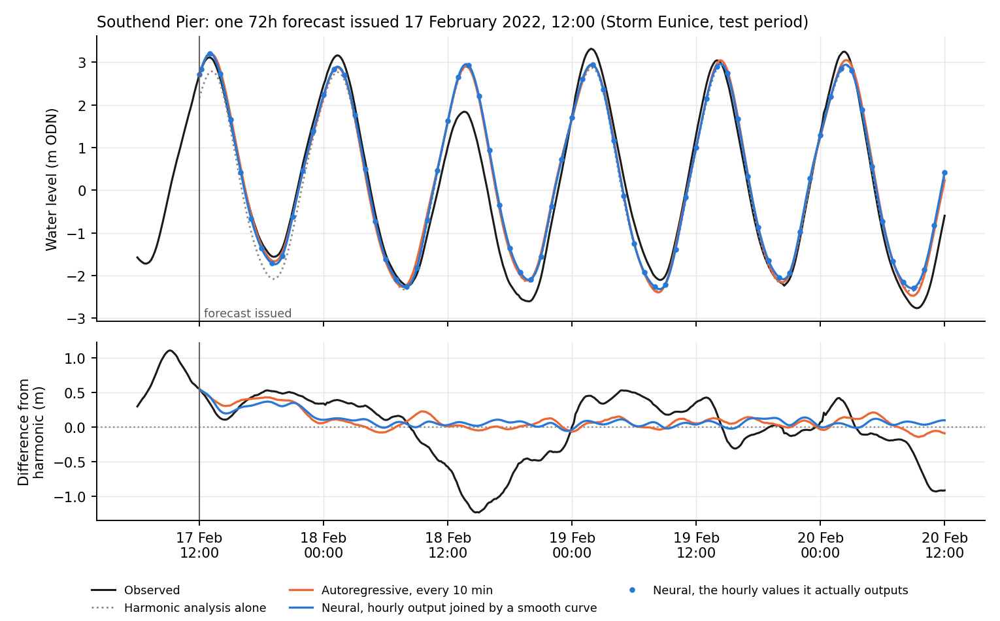
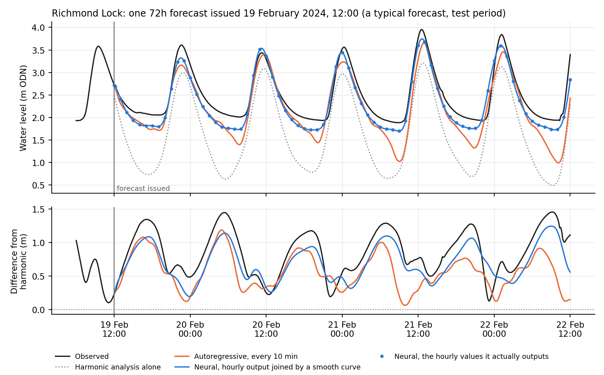
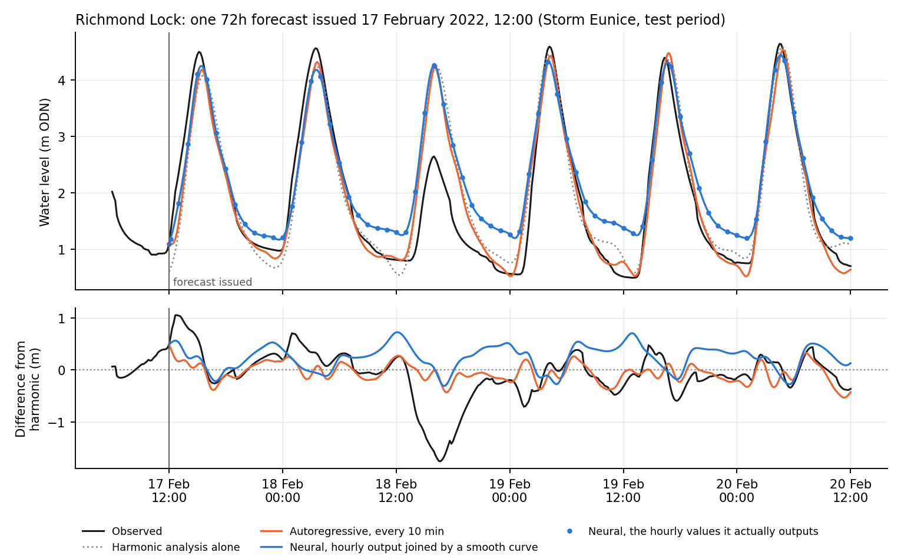
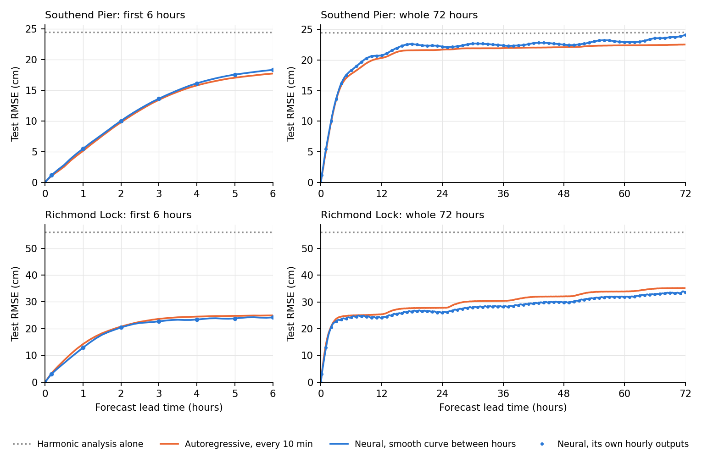

# Tidal Thames forecasting: progress since the dissertation (November 2026)

## What changed since the dissertation

- **Short-lead fix.** The dissertation's 73-lead neural model (10 min, then hourly to 72h, on top of the harmonic prediction) was poor at short leads: at 10 min it was worse than simply carrying the current surge forward ("persistence"). The cause was that every lead counted equally in training, so the 10-min lead was under 0.1% of what the model optimised. The new model starts from persistence and learns a correction, and each lead's error is weighted by how hard that lead is for persistence. Five versions were compared on validation (2018 to 2020) under a rule fixed in advance; this one won at both gauges and is the only one scored on test (2021 to 2024).
- **A data leak was found and fixed.** NRFA daily river flow and rainfall cover 09:00 to 09:00 and are dated by their start, so they are only known 33h after midnight on that date. The dissertation's stage 3 (weather and river) models used them up to 33h early. This flattered the stage 3 results at both gauges; it does not affect any result below, which uses no river data.
- **Continuous output and high-water scoring.** The hourly forecast is interpolated to every 10 min (cubic spline through the forecast correction to the harmonic prediction), and high and low waters are scored for height and timing.

## Headline results (test, 2021 to 2024; RMSE in cm, averaged over all forecasts)

**Southend Pier**

| method | 10 min | 1h | 6h | 24h | 48h | 72h |
|---|---|---|---|---|---|---|
| Harmonic analysis alone | 24.5 | 24.5 | 24.4 | 24.4 | 24.4 | 24.5 |
| Persistence of current surge | 2.0 | 10.3 | 27.1 | 30.8 | 32.5 | 34.6 |
| Best classical (autoregressive surge model) | **1.2** | **5.1** | **17.7** | **21.7** | **22.1** | **22.5** |
| Neural, dissertation | 4.9 | 6.5 | 18.2 | 21.8 | 22.3 | 23.8 |
| Neural, new | 1.3 | 5.5 | 18.3 | 22.2 | 22.5 | 24.1 |

**Richmond Lock**

| method | 10 min | 1h | 6h | 24h | 48h | 72h |
|---|---|---|---|---|---|---|
| Harmonic analysis alone | 56.0 | 56.0 | 56.0 | 56.0 | 56.0 | 56.0 |
| Persistence of current surge | 5.5 | 26.0 | 54.2 | 37.7 | 49.0 | 54.0 |
| Best classical (autoregressive surge model) | 3.3 | 14.3 | 24.9 | 27.8 | 32.1 | 35.2 |
| Neural, dissertation | 9.2 | 14.7 | **23.0** | **25.6** | 29.8 | **33.2** |
| Neural, new | **3.1** | **12.9** | 24.2 | 26.0 | **29.8** | 33.5 |

High water, new neural model with interpolation against harmonic analysis alone (test): Southend height error 19.9 cm RMSE (harmonic 25.1 cm), timing 5.6 min mean absolute error (harmonic 7.8 min); Richmond 29.0 cm (43.5 cm) and 9.8 min (15.0 min).

## What the classical baselines show, and how the comparison was made fair

The classical models (autoregressive, ridge regression, Gaussian process, SARIMA, dynamic harmonic regression) were each tuned on validation with the same effort, then frozen and scored once on test. All methods share the same forecast start times, leads, quality mask (flagged, stuck and patched values excluded), harmonic fit (2004 to 2017 only) and error code. Differences are tested with a 7-day block bootstrap, which respects the autocorrelation of tidal errors, averaged over all 73 leads and over 24h to 72h.

- **Richmond:** the neural model is better than the best classical model by 1.8 cm on average (2.2 cm over 24h to 72h), and the difference is statistically clear.
- **Southend:** the autoregressive model is better than the neural model by 0.7 cm, also statistically clear. At the estuary mouth the surge behaves close to linearly, which a linear model captures fully.
- **The best classical model's edge is history, not method.** It uses the last 30 days (Southend) or 6 months (Richmond) of the surge residual, against 16h for the neural model. Held to 16h, the same autoregressive model is worse than the neural model at both gauges on validation (Southend 22.2 against 20.9 cm, Richmond 33.9 against 26.0 cm, averaged over the 73 leads). The next section explains how these history lengths were chosen and shows every classical model at 16h.
- **For a port authority:** harmonic prediction plus an autoregressive correction is cheap, transparent (a table of weights) and runs in any telemetry system. A neural model is worth its extra cost only where river flow makes the tide nonlinear, as at Richmond. Details: Claude Doc "Classical baselines vs neural networks".

## How much past record the models use, and why it matters

### The two kinds of model in one paragraph each

Both kinds of model start from the harmonic prediction and only forecast the **surge residual**: observed level minus harmonic prediction, which is mostly weather and river effects plus slow changes in mean level.

- **Autoregressive model (the best classical model).** The forecast for each lead time is a fixed weighted sum of past residual values. The weights are worked out once from the 2004 to 2017 record and never change, so the whole model is a table of numbers that can be printed and checked. It is linear: twice the surge in gives twice the correction out.
- **Neural model.** It also reads past residuals (and the harmonic prediction), but it learns its own rules from the data, and those rules can bend: for example, it can react differently to the same surge on a spring tide and on a neap tide, or at high and at low water. It always looks back 16 hours. That length was fixed in the dissertation and has not been tuned.

### Why 30 days at Southend and 6 months at Richmond

Nobody picked these numbers by hand. Each classical model has a setting for how far back it may look, and an automatic search tried nine lengths from 16 hours to 1 year (40 trials for the autoregressive model at each gauge). The search scored every trial on the validation years (2018 to 2020) only and kept the length with the lowest average error over all 73 lead times. Figure S1 shows the best score at each length.

*Figure S1. Validation RMSE (2018 to 2020, the score the search used: the average over all 73 lead times) of the best autoregressive model at each history length. The ring marks the length the search kept. The dashed line is the new neural model, which always uses 16 hours.*

What the curves show:

- **Southend.** Error falls steadily up to 30 days and then levels off. Going to a full year makes it worse: the model then has 52,560 weights to estimate, and the very old values add estimation noise without adding information. 30 days is about one lunar month, so it covers two full spring-neap cycles. Averaging the residual over that window in effect cancels the small tidal errors the harmonic fit leaves behind, and what remains is an estimate of the current mean-level offset. At long lead times that offset is most of what can be predicted without a weather forecast.
- **Richmond.** Error falls steeply up to 30 days and then barely moves: 29.6 cm at 30 days against 29.3 cm at 180 days, a 0.3 cm difference. The search kept 180 days because it was lowest, but in practice a 30-day model would perform almost the same. Richmond gains more from longer history than Southend because river flow changes over weeks to months, and the residual there carries that slow river signal.
- **The neural model with only 16 hours** beats the autoregressive model at every history length at Richmond, and at Southend it is beaten only when the autoregressive model looks back between 30 days and 6 months.

### How the classical models do with the same 16 hours as the neural model

Every classical model that has a history setting (autoregressive, ridge regression, Gaussian process) was also searched separately with history capped at 16 hours, the neural model's window, so the comparison is like for like. Each was tuned on validation in the same way and then scored once on test.

**Test RMSE (cm), 2021 to 2024, all models looking back 16 hours unless stated**

| Southend Pier | 10 min | 1h | 6h | 24h | 48h | 72h | average, all leads | average, 24h to 72h |
|---|---|---|---|---|---|---|---|---|
| Harmonic analysis alone | 24.5 | 24.5 | 24.4 | 24.4 | 24.4 | 24.5 | 24.4 | 24.4 |
| Autoregressive, 16h | 1.2 | 6.1 | 20.4 | 24.0 | 24.1 | 24.5 | 22.9 | 24.3 |
| Ridge regression, 16h | 1.2 | 5.8 | 20.2 | 22.8 | 23.6 | 24.4 | 22.3 | 23.8 |
| Gaussian process, 16h | 2.1 | 7.6 | 20.6 | 23.2 | 23.9 | 24.8 | 22.8 | 24.2 |
| **Neural, 16h** | 1.3 | **5.5** | **18.3** | **22.2** | **22.5** | **24.1** | **21.5** | **22.8** |
| *Autoregressive, 30 days (for reference)* | *1.2* | *5.1* | *17.7* | *21.7* | *22.1* | *22.5* | *20.8* | *22.2* |

| Richmond Lock | 10 min | 1h | 6h | 24h | 48h | 72h | average, all leads | average, 24h to 72h |
|---|---|---|---|---|---|---|---|---|
| Harmonic analysis alone | 56.0 | 56.0 | 56.0 | 56.0 | 56.0 | 56.0 | 56.0 | 56.0 |
| Autoregressive, 16h | 3.3 | 17.4 | 29.6 | 31.7 | 38.6 | 42.9 | 35.6 | 39.0 |
| Ridge regression, 16h | 3.3 | 17.5 | 29.4 | 29.6 | 35.7 | 39.8 | 33.4 | 36.5 |
| Gaussian process, 16h | 3.5 | 19.2 | 30.4 | 33.3 | 42.4 | 48.0 | 38.5 | 42.9 |
| **Neural, 16h** | **3.1** | **12.9** | **24.2** | **26.0** | **29.8** | **33.5** | **27.9** | **30.1** |
| *Autoregressive, 6 months (for reference)* | *3.3* | *14.3* | *24.9* | *27.8* | *32.1* | *35.2* | *29.7* | *32.3* |

*Figure S2. Test RMSE (2021 to 2024) at each lead time. Dashed lines: classical models held to 16 hours of history. Solid orange: the autoregressive model with its full 30-day (Southend) or 6-month (Richmond) history. Blue: the neural model (16 hours).*

In plain terms:

- **Given the same information, the neural model is the most accurate model at both gauges.** At Southend it beats the best 16-hour classical model (ridge regression) by 0.8 cm on average and by 1.0 cm over 24h to 72h. At Richmond the margin is 5.5 cm on average and 6.4 cm over 24h to 72h.
- **Giving the autoregressive model a month of history is worth more than the neural model's flexibility at Southend, but not at Richmond.** At Southend the 30-day model edges past the neural model (20.8 against 21.5 cm). At Richmond even six months of history leaves it 1.8 cm behind.
- **Why the ranking flips at Southend:** at the estuary mouth, surge and tide add together almost linearly, so the neural model's flexibility buys little, and the extra weeks of history (the mean-level estimate) matter more. At Richmond, river flow changes how the tide behaves, especially at low water (Figure S3, Richmond typical forecast), and only the neural model can represent that.
- **The obvious next experiment** is to give the neural model the same long history. One version (the last 30 daily-mean residuals) was tried at Southend and did not help on validation (`CHANGELOG.md`, 2026-11-10). A better-designed version is a candidate for future work, not a result yet.
- Classical models fitted to the **water level itself** rather than to the surge residual are far worse at 16 hours (45 to 54 cm average, against 22 to 39 cm on the residual), because 16 hours is too short to learn the tide from scratch. This is why every method here builds on the harmonic prediction.

## Continuous forecasts: what they look like

The neural model outputs one value at 10 minutes and then one per hour up to 72h. To give a curve every 10 minutes, its correction to the harmonic prediction is joined by a smooth curve (cubic spline) and added back to the harmonic prediction, which supplies the shape of the tide between the hours. The autoregressive model needs no joining: it forecasts every 10-minute step directly, which is easy for a linear model.

The figures below show single forecasts from the test period. The top panel is water level; the bottom panel is the same thing minus the harmonic prediction, which makes the differences between the forecasts much easier to see. The "storm" date is the one used for the example figures in the dissertation. The "typical" date was chosen by rule, not by eye: of all forecasts issued at 12:00 in 2021 to 2024, it is the one whose neural error over 72 hours is the median (15.5 cm at Southend, 21.6 cm at Richmond).

**Southend Pier**

**Richmond Lock**

*Figure S3. One 72h forecast, issued at the vertical line, every 10 minutes. Black: observed. Grey dotted: harmonic analysis alone. Orange: autoregressive model. Blue line: neural model joined between its hourly outputs (blue dots). Bottom panels: each curve minus the harmonic prediction.*

What to look for:

- **Both models track the first few hours closely**, because both start from the surge that is happening now. After that both drift back towards a modest, steady offset from the harmonic prediction, because neither can see the coming weather.
- **Richmond, typical forecast (February 2024):** observed low waters sit at about 1.9 to 2.1 m ODN, 1.2 to 1.5 m above the harmonic prediction, which points to high river flow. The neural model keeps its low waters up at about 1.7 to 1.8 m for the whole 72 hours. The autoregressive model lets them sag to between 1.0 and 1.5 m, because a fixed linear rule cannot "know" that the offset is larger at low water than at high water. This is the nonlinearity the neural model captures.
- **Storm Eunice (18 February 2022)** produced a negative surge of more than 1 m at Southend and about 1.7 m at Richmond about a day after the forecasts were issued. Neither model anticipated it, and no model in this study can, because none uses a weather forecast. Events like this are what the national storm surge forecast is for; this work complements it rather than replaces it.

*Figure S4. Test RMSE at every 10-minute lead time from 0 to 72h (forecasts issued every hour, 2021 to 2024). Blue dots: the neural model's own hourly outputs. Blue line: the joined curve between them. Orange: the autoregressive model, forecast directly every 10 minutes.*

- **Joining the hourly outputs costs nothing visible:** the blue line passes smoothly through the dots, with no bumps between hours. At 30 minutes the joined neural forecast has an error of 2.8 cm at Southend (autoregressive 2.5 cm) and 7.1 cm at Richmond (autoregressive 8.2 cm).
- The curves confirm the overall ranking: almost level at Southend, with the autoregressive model slightly ahead at most lead times (by 1.6 cm at 72h), and the neural model ahead at Richmond at almost every lead time.

Numbers behind the figures: `outputs/diagnostics_2026-11/supervisor_figs_S1_history.csv`, `supervisor_figs_S2_same_history.csv` and `supervisor_figs_S4_rmse_433.csv`; figure script `models/plot_supervisor_figures.py`. History-length search: `outputs/[richmond/]baselines/search/search_ar_residual_x.csv`. 16-hour test scores: `outputs/[richmond/]baselines/baseline_metrics.csv` (`*_parity` rows).

## Open problems

1. At Southend the neural model does not beat a well-tuned linear model.
2. The short-lead fix costs a few millimetres at 24h to 72h.
3. Every method under-predicts high waters, and the harmonic prediction does so most at Southend (by 14 cm on test against 8 cm on validation). Mean level at Southend has risen 5 to 7 cm above the 2004 to 2017 fit by 2022 to 2024. Giving the neural model the last 30 days of mean level did not help on validation.
4. Richmond low waters are held up by a control near -1.0 m ODN, so they are not scored.
5. The stage 3 weather and river model has not been retrained since the leak fix. At Richmond its saved version is effectively untrained: it stopped improving after the first pass through the data.

## Decisions I need from you

1. **Horizon:** 48h (the Port of London's need, and the model is weakest at its last lead) or 72h?
2. **What "continuous" should mean:** hourly forecasts interpolated to 10 min (current), a model that outputs every 10 min directly, or a forecast that can be issued and updated at any time?
3. **Lead story:** Richmond, where the neural model clearly wins, with Southend as the linear control case? Or both treated equally?
4. **Stage 3:** retrain it once, leak-free and tuned for Richmond, or move it to future work?
5. **Other gauges as inputs** (for example upstream or downstream Thames gauges): in scope for this paper, or later?

Sources: `reports/2026-11-nov-fixes/02_overnight_results.md`, `01_diagnostics.md`, and `CHANGELOG.md`.
