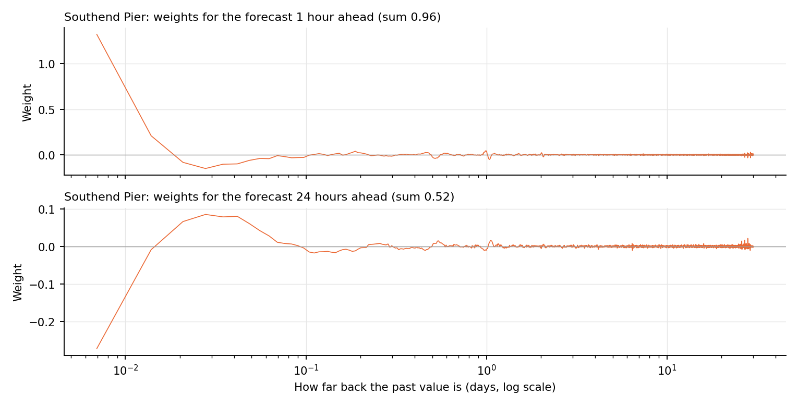
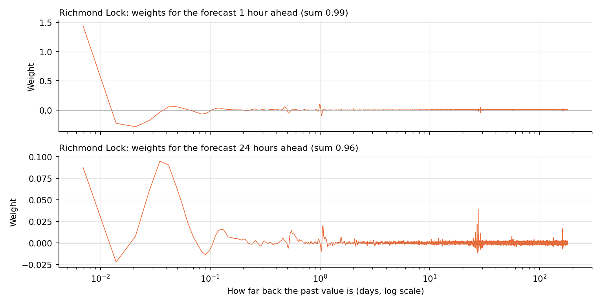
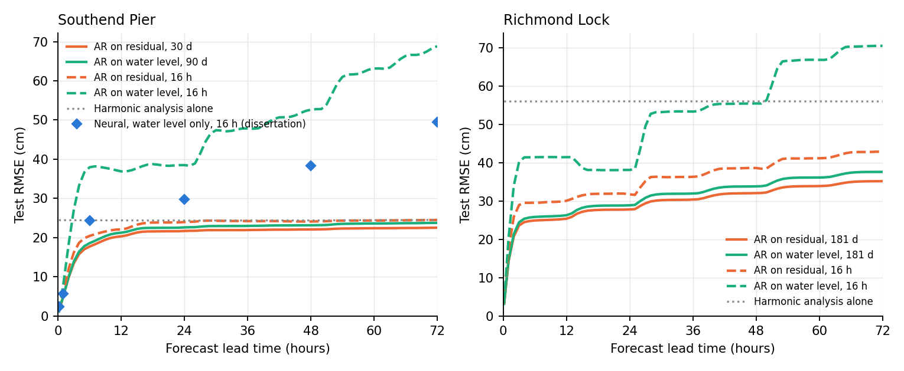
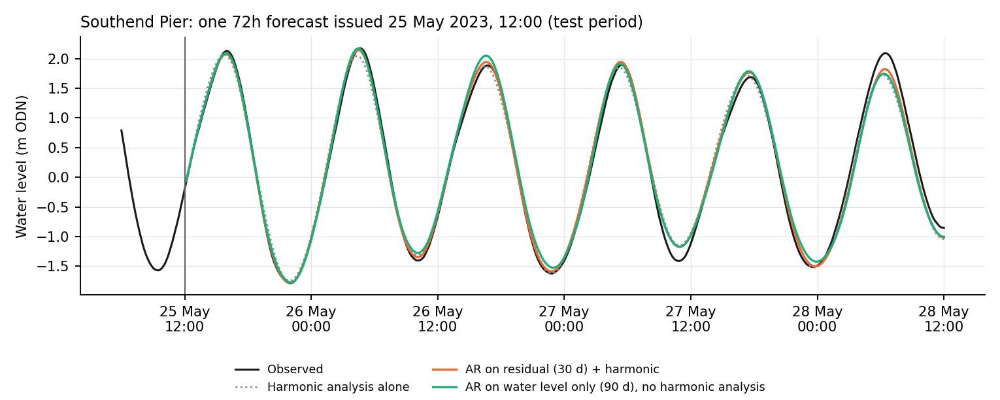
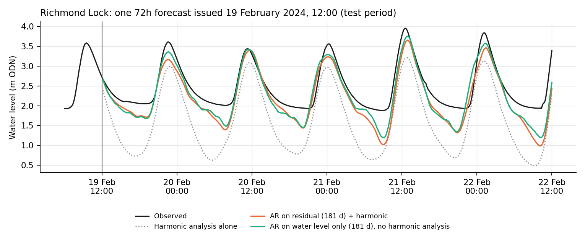

# The long autoregressive (AR) model: concepts and code

This note is for checking the best classical model line by line. Each step gives the idea, the formula, and the code that does it. Line numbers refer to commit `0d17a2c` on `paper/nov-fixes`.

**Origin.** The model is a custom implementation in this repo, `utils/models/baselines.py`, added in commit `ba70745` (2026-11-09, co-authored with Claude). It is not a call to a forecasting library. It uses standard numerical routines underneath: `scipy.linalg.solve_toeplitz` (Levinson recursion), `numpy` FFTs, and `numba` for speed. A library model was not used because the orders are very large (4,320 and 26,000 lags) and the record has gaps.

## 1. The model in one line

Let $r_t$ be the surge residual at 10-minute step $t$: observed level minus the harmonic prediction. Let $\mu$ be its mean over the training years (2004 to 2017). The model is a pure autoregression of order $p$:

$$r_t - \mu = \sum_{k=1}^{p} \pi_k \,(r_{t-k} - \mu) + \varepsilon_t$$

The forecast for lead $h$ is then added back onto the harmonic prediction:

$$\hat{\eta}_{t+h} = \text{harmonic}_{t+h} + \hat{r}_{t+h}$$

| | Southend | Richmond |
|---|---|---|
| order $p$ (lags of 10 min) | 4,320 (30 days) | 26,000 (180.6 days) |
| estimator | Yule-Walker | Yule-Walker |
| jitter (Section 4) | 1.0e-13 (effectively none) | 1.3e-3 |
| fitted on | train only (before 2018) | train only (before 2018) |
| validation RMSE used for choosing (cm) | 21.15 | 29.28 |

Source: `models/checkpoints/[richmond/]baselines/best_configs.json`, entry `ar_residual`.

There are no moving-average, seasonal or differencing terms. The only things estimated are the $p$ coefficients $\pi_k$ and the mean $\mu$.

## 2. The series being modelled

**Concept.** Harmonic analysis removes the astronomical tide. What remains (weather surge, river effects, slow mean-level change and small leftover tidal errors) is what the AR forecasts. The harmonic fit uses the 2004 to 2017 data only. It is the same fit the neural models use.

**Code.**
- `Series.track` (`utils/models/baselines.py:50`): `level - utide` for the residual track, `level` alone for the level track (Section 9).
- `_utide_on_grid` (`baselines.py:54`): the train-only UTide reconstruction on the 10-minute grid.
- `load_series` (`baselines.py:68`): builds the regular 10-minute grid, with NaN wherever the gauge has no value. `upto=` cuts the arrays before anything sees them, so the search physically cannot reach test data.

## 3. Autocovariance with gaps

**Concept.** Yule-Walker needs the autocovariance $\gamma(k)$, which says how strongly the residual now is related to the residual $k$ steps earlier. The record has gaps. So for each lag $k$, the products are summed only over pairs where both values exist, and the sum is divided by the number of such pairs $n_k$:

$$\hat\gamma(k) = \frac{1}{n_k} \sum_{t:\ r_t,\ r_{t-k} \text{ both present}} (r_t - \bar r)(r_{t-k} - \bar r)$$

This is the "amplitude-modulated" estimator for missing data (Parzen, 1963). With no gaps it reduces to the "adjusted" estimator, which divides by $n - k$.

**Code.** `gappy_acov` (`baselines.py:118`). The sums are computed for all lags at once by FFT: `fz` holds the data with zeros in the gaps, and `fm` holds a 1/0 mask whose autocorrelation counts the pairs $n_k$.

## 4. Estimating the coefficients: Yule-Walker

**Concept.** For an AR(p), the autocovariances satisfy the Yule-Walker equations:

$$\begin{pmatrix}\gamma(0) & \gamma(1) & \cdots & \gamma(p-1)\\ \gamma(1) & \gamma(0) & \cdots & \gamma(p-2)\\ \vdots & & \ddots & \vdots\\ \gamma(p-1) & \cdots & & \gamma(0)\end{pmatrix} \begin{pmatrix}\pi_1\\ \vdots\\ \pi_p\end{pmatrix} = \begin{pmatrix}\gamma(1)\\ \vdots\\ \gamma(p)\end{pmatrix}$$

The matrix is Toeplitz (constant along each diagonal), so it can be solved with the Levinson recursion in $O(p^2)$ operations instead of $O(p^3)$. That makes $p = 26{,}000$ feasible on a laptop.

**Jitter.** $\gamma(0)$ is multiplied by $(1 + \text{jitter})$ before solving. This is diagonal loading: a small ridge penalty that shrinks the coefficients slightly and keeps the system well conditioned. The search tuned it on a log scale from 1e-13 to 0.1. Southend chose essentially zero; Richmond chose 0.13%.

**Code.** `fit_ar` (`baselines.py:312`): `acov = gappy_acov(y_train, order)`, then `acov[0] *= 1 + jitter`, then `solve_toeplitz(acov[:order], acov[1:order + 1])`.

**Alternative estimator.** Burg's method (`_burg`, `baselines.py:152`) estimates the coefficients from forward and backward prediction errors within each gap-free stretch (`segments`, `baselines.py:178`). It always gives a stable model. The search tried both. Yule-Walker won for the residual at both gauges; Burg won for the water level itself (Section 9).

## 5. From one step ahead to 72 hours ahead

**Concept.** The fitted model predicts one step (10 minutes) ahead. For lead $h$ it is rolled forward: predict $t+1$, treat that prediction as if it were data, predict $t+2$, and so on. This is an **iterated** multi-step forecast, as opposed to a **direct** one, where a separate model is fitted for each lead (as the neural model does).

Because every step is linear, the rollout can be written exactly as one fixed weight vector per lead:

$$\hat r_{t+h} - \mu = \sum_{j=1}^{p} w_{h,j}\,(r_{t+1-j} - \mu)$$

The weights obey the recursion

$$w_{h,j} = \pi_{h-1+j} + \sum_{k=1}^{h-1} \pi_k\, w_{h-k,j}$$

Here the first term is the coefficient that reaches directly back to $r_{t+1-j}$, and the sum covers the paths that pass through earlier forecasts. The terms are zero where the index exceeds $p$.

**Code.**
- `pi_to_weights` (`baselines.py:278`): builds the table `full[h, j]` row by row with exactly this recursion. It returns the rows for the requested leads: the 73 dense leads, or all 432 ten-minute leads for the continuous output.
- `linear_from_pi` (`baselines.py:302`): wraps the table, the train mean and the train range into a `LinearForecaster`.

The weights for a 1-hour and a 24-hour forecast are plotted in Figure L3. At Southend the 1-hour forecast leans almost entirely on the last few values (weight 1.3 on the newest). The 24-hour forecast spreads small weights across the whole 30 days.

*Figure L3. Weight given to each past residual value (log time axis) for the forecasts 1 hour and 24 hours ahead. The sum of the weights is the share of a sustained offset that is carried forward.*

## 6. Making a forecast, and what happens at gaps

**Concept.** At issue time $t$ the forecast is the weighted sum above, using only data at or before $t$. If some past values are missing, they are first filled in from earliest to latest with the model's own one-step forecast. Each filled value uses only earlier data, and it is clipped to the range seen in training.

**Code.**
- `LinearForecaster.forecast` (`baselines.py:267`): calls `fill_gaps`, then `_apply_weights`, then adds the mean back.
- `fill_gaps` (`baselines.py:224`): the left-to-right gap filling.
- `_apply_weights` (`baselines.py:241`): the weighted sum for every anchor and lead. Lag 1 is the value at the anchor itself, which is the newest observation.
- Two tests check that nothing leaks from the future: `test_forecast_ignores_the_future` and `test_gap_fill_uses_only_the_past` (`tests/test_baselines.py:143` and `:158`).

## 7. Choosing the order (and estimator and jitter)

**Concept.** The order was **not** chosen by AIC or BIC. Those pick 4,636 and 375 at Southend, and they measure one-step fit rather than 72-hour forecast skill. Instead, an automatic search (Optuna, TPE sampler, 40 trials per gauge) tried:
- orders from the grid 16 h, 3 d, 15 d, 30 d, 60 d, 90 d, 120 d, 180 d and 1 yr;
- both estimators;
- and the jitter.

Each trial was fitted on train and scored on validation (2018 to 2020, hourly forecast times). The score was the mean squared error at each of the 73 leads, averaged with equal weight per lead. The lowest score won. A separate 16-hour study searched orders 16 to 96 for the like-for-like comparison with the neural model.

**Code.**
- `models/search_baselines.py`:
  - `suggest` (line 75) defines the search space: AR orders from `identified_ranges.json`, and `PARITY_ORDERS` at line 53.
  - `objective` (line 116) runs `build_model`, then `forecast`, then `mean_lead_mse`.
- `utils/models/config.py`, `BASELINE_HISTORY_GRID`: the order grid.
- `baselines.build_model` (`baselines.py:801`): the `ar` branch is `fit_ar`, then `linear_from_pi`.
- `baselines.mean_lead_mse` (`baselines.py:109`): the validation criterion.
- Trial-by-trial results: `outputs/[richmond/]baselines/search/search_ar_residual_x.csv`. The best score at each order is plotted in Figure S1 of `03_supervisor_summary.md`.

## 8. Test scoring

`models/eval_baselines.py` (lines 108 to 117) rebuilds each frozen config from `best_configs.json`, fitted on train only. It then forecasts every test anchor and adds the harmonic prediction back. Scoring uses the same anchors, masks and RMSE code as the neural models. Outputs are in `outputs/[richmond/]baselines/baseline_metrics.csv`.

## 9. Test: the same models on the water level directly (no harmonic analysis)

This is the classical equivalent of the dissertation's first neural networks, which forecast the water level itself. It was already part of the baselines audit (the "level" track): every classical model was tuned on validation and scored on test on both the level and the residual. Nothing new was trained for this note. The code is the same; only `Series.track('level')` changes, and nothing is added back.

**Test RMSE (cm), 2021 to 2024**

| Southend | 10 min | 1h | 6h | 24h | 48h | 72h | average, all leads | average, 24 to 72h |
|---|---|---|---|---|---|---|---|---|
| Harmonic analysis alone | 24.5 | 24.5 | 24.4 | 24.4 | 24.4 | 24.5 | 24.4 | 24.4 |
| AR on residual, 30 d (+ harmonic) | 1.2 | 5.1 | 17.7 | 21.7 | 22.1 | 22.5 | **20.8** | **22.2** |
| AR on water level, 90 d (Burg) | 1.2 | 5.1 | 18.6 | 22.6 | 23.2 | 23.8 | 21.8 | 23.3 |
| AR on residual, 16 h | 1.2 | 6.1 | 20.4 | 24.0 | 24.1 | 24.5 | 22.9 | 24.3 |
| AR on water level, 16 h | 1.4 | 8.0 | 38.0 | 38.5 | 52.6 | 68.8 | 47.8 | 54.8 |
| Neural on water level, 16 h (dissertation stage 2 without the tide input) | 2.3 | 5.8 | 24.4 | 29.8 | 38.3 | 49.4 | | |

| Richmond | 10 min | 1h | 6h | 24h | 48h | 72h | average, all leads | average, 24 to 72h |
|---|---|---|---|---|---|---|---|---|
| Harmonic analysis alone | 56.0 | 56.0 | 56.0 | 56.0 | 56.0 | 56.0 | 56.0 | 56.0 |
| AR on residual, 181 d (+ harmonic) | 3.3 | 14.3 | 24.9 | 27.8 | 32.1 | 35.2 | **29.7** | **32.3** |
| AR on water level, 181 d (Burg) | 3.2 | 14.5 | 25.8 | 28.9 | 33.8 | 37.6 | 31.3 | 34.2 |
| AR on residual, 16 h | 3.3 | 17.4 | 29.6 | 31.7 | 38.6 | 42.9 | 35.6 | 39.0 |
| AR on water level, 16 h | 3.4 | 20.3 | 41.4 | 38.1 | 55.4 | 70.5 | 52.2 | 59.5 |

Sources:
- AR rows: `outputs/[richmond/]baselines/baseline_metrics.csv` (`ar_level`, `ar_level_parity`, `ar_residual`, `ar_residual_parity`).
- Neural row: `outputs/stage2_outputs/stage2_ablation_metrics.csv`. It is Southend only, scored at the sparse model's 7 leads on its own test windows, so it is indicative rather than strictly matched.

The dissertation's stage 1 networks are left out on purpose: they forecast one step and roll forward, so their long-lead numbers are not comparable.

*Figure L1. Test RMSE by lead. Orange: AR on the harmonic residual. Green: AR on the water level itself. Solid lines use the searched history; dashed lines are capped at 16 hours. Blue diamonds (Southend): the dissertation's stage 2 network without the tide input, 16 hours.*

*Figure L2. One 72-hour forecast every 10 minutes from both AR versions, on the "typical" issue times of the supervisor summary.*

**What this shows**

1. **With long history, the AR learns the tide by itself.**
   - On the water level alone, with 90 days (Southend) or 181 days (Richmond) of history and no harmonic analysis, it is only 1.0 cm (Southend) and 1.6 cm (Richmond) worse on average than harmonic analysis plus AR.
   - Figure L2 shows it reproducing the tidal curve, including Richmond's lopsided shape and raised low waters.
   - The reason is that a linear recursion can carry a sinusoid forward indefinitely: $x_t = 2\cos(\omega)\,x_{t-1} - x_{t-2}$ is exactly a cosine of frequency $\omega$. Given enough lags, the AR fits all the main constituents at once from the recent record. In effect it performs its own harmonic analysis on the last few months.
2. **With 16 hours of history it fails, and does worse than harmonic analysis alone beyond a few hours.** This is the Rayleigh criterion that hydrographers know. To tell two constituents apart you need a record of at least $1/|f_1 - f_2|$:

   | Constituents | Record needed |
   |---|---|
   | M2 and S2 (the spring-neap cycle) | 14.8 days |
   | K1 and O1 | 13.7 days |
   | M2 and N2 | 27.6 days |

   Sixteen hours cannot resolve any of these. So the forecast drifts out of phase as the lead grows, and the dashed green line in Figure L1 climbs in steps. The neural network without the tide input has the same problem, slightly less severely.
3. **So harmonic analysis matters most when the history is short.**
   - With long history its contribution is real but modest (1.0 to 1.6 cm).
   - With 16 hours it is the difference between a useful forecast and one worse than the tide table.
   - This supports building the neural model on top of the harmonic prediction rather than asking it to learn the tide.
4. **Why the Burg estimator wins on the water level.** The level is dominated by sharp spectral lines (the tide). Burg's estimates are always stable and tend to resolve sharp peaks better than Yule-Walker's, which can smear them. The residual has no strong lines, so the two estimators behave alike there.

## 10. Independent checks

`models/check_long_ar.py` compares the three core building blocks with independent references (run on 2026-11-10):

| Check | Reference | Largest difference |
|---|---|---|
| Yule-Walker AR(200) on 50,000 gap-free Southend train residuals | statsmodels `yule_walker(method='adjusted')` | 1.1e-12 |
| Gap-aware autocovariance, lags 0 to 30, a stretch with 25 missing values | brute-force sum over present pairs | 2.8e-17 |
| Weight table for 24 steps | explicit step-by-step recursive rollout | 1.7e-16 |

`tests/test_baselines.py` also checks:
- ACF and PACF against statsmodels (line 33);
- recovery of known AR(2) coefficients from 200,000 simulated values with a 100-value gap, for both estimators (line 63);
- the two no-leakage tests (lines 143 and 158).

**Not independently checked here:** the Burg implementation against a library version (only through the AR(2) recovery test), and the very large orders directly, which are too large for statsmodels. The Levinson solve at those sizes is the same scipy routine that the AR(200) check exercises.

## 11. Reading list, by step

I have not looked these references up. Check the details before citing.

| Step | Reading |
|---|---|
| AR models, Yule-Walker, Burg, forecasting (Sections 1, 4, 5) | Brockwell & Davis, *Introduction to Time Series and Forecasting*, 3rd ed. (2016), chapters on ARMA estimation and prediction. Box, Jenkins, Reinsel & Ljung, *Time Series Analysis: Forecasting and Control*, 5th ed. (2015) |
| Levinson recursion (Section 4) | Levinson (1947); Durbin (1960) |
| Burg's method (Section 4) | Burg (1967, 1975), maximum entropy spectral analysis |
| Gap-aware autocovariance (Section 3) | Parzen (1963), "On spectral analysis with missing observations and amplitude modulation" |
| Why a very long AR is legitimate (Section 1) | Berk (1974), *Annals of Statistics*; Lewis & Reinsel (1985), *Journal of Multivariate Analysis* |
| Iterated against direct multi-step forecasts (Section 5) | Marcellino, Stock & Watson (2006), *Journal of Econometrics*; Chevillon (2007), *Journal of Economic Surveys* |
| Choosing settings on validation (Section 7) | Hyndman & Athanasopoulos, *Forecasting: Principles and Practice*, 3rd ed. (2021); Akiba et al. (2019), Optuna; Bergstra et al. (2011), TPE |
| Comparing forecasts on test | Diebold & Mariano (1995); Künsch (1989) and Politis & Romano (1994), block bootstrap |
| Tides, Rayleigh criterion, surge (Sections 2, 9) | Pugh & Woodworth, *Sea-Level Science* (2014); Codiga (2011), UTide report; Prandle & Wolf (1978), surge-tide interaction in the North Sea and River Thames; Horsburgh & Wilson (2007), *JGR Oceans* |

Figures: `models/plot_long_ar_figures.py`. Numbers behind Figure L1: `outputs/diagnostics_2026-11/long_ar_L1_by_lead.csv`.
