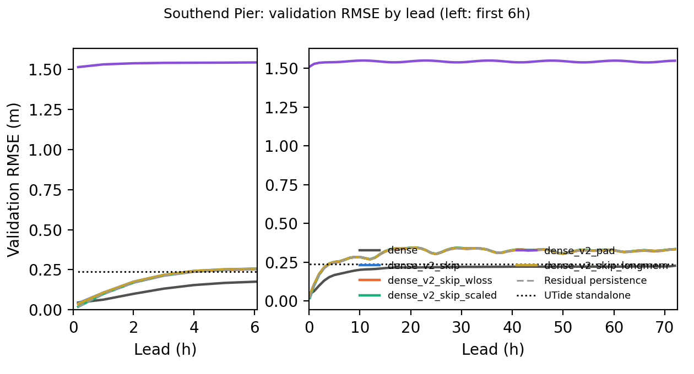
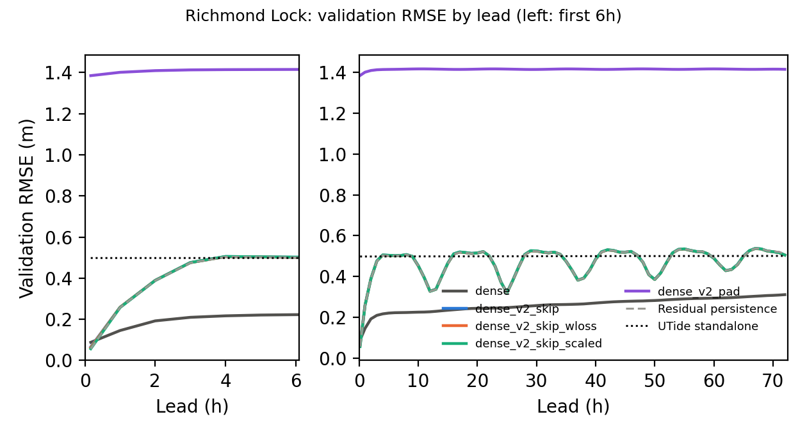
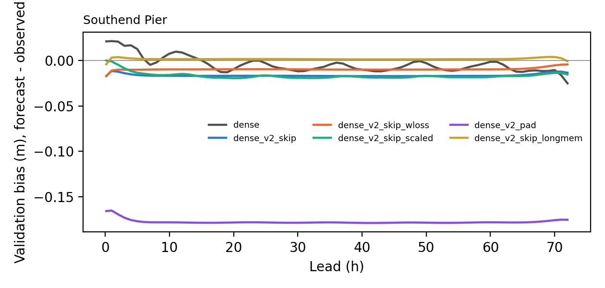
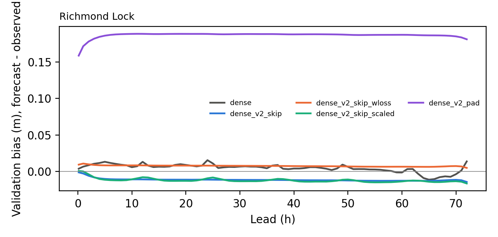

# Overnight results (DRY RUN, smoke settings: numbers meaningless)

Queue started 2026-11-10 00:17 from commit `a2f2c86` on branch `paper/nov-fixes`. Report written 2026-11-10 00:40. Deadline 2026-11-10 17:00 GMT. Development decisions use validation only; test was scored only for the winner per gauge (see CHANGELOG).

## Step status

| step | status | start | end | minutes | note / log |
|---|---|---|---|---|---|
| 01_train_skip_wloss_southend | ok | 00:17 | 00:19 | 1.5 |  |
| 02_train_skip_scaled_southend | ok | 00:19 | 00:20 | 1.5 |  |
| 03_train_pad_southend | ok | 00:20 | 00:22 | 2.0 |  |
| 04_train_skip_wloss_richmond | ok | 00:22 | 00:24 | 1.5 |  |
| 05_train_skip_scaled_richmond | ok | 00:24 | 00:25 | 1.5 |  |
| 06_train_pad_richmond | ok | 00:25 | 00:27 | 2.0 |  |
| 07_train_skip_southend | ok | 00:27 | 00:29 | 1.5 |  |
| 08_select_southend | ok | 00:29 | 00:29 | 0.3 |  |
| 08_select_richmond | ok | 00:29 | 00:29 | 0.3 |  |
| 08_testscore_winner_southend | ok | 00:29 | 00:31 | 2.3 | test-scored winner dense_v2_skip_scaled |
| 08_testscore_winner_richmond | ok | 00:31 | 00:34 | 2.3 | test-scored winner dense_v2_skip_scaled |
| 09_baselines_vs_winner_southend | ok | 00:34 | 00:34 | 0.8 |  |
| 09_baselines_vs_winner_richmond | ok | 00:34 | 00:35 | 0.8 |  |
| 10_postprocess_southend_val | ok | 00:35 | 00:35 | 0.3 |  |
| 10_postprocess_southend_test | ok | 00:35 | 00:36 | 0.3 |  |
| 10_postprocess_richmond_val | ok | 00:36 | 00:36 | 0.3 |  |
| 10_postprocess_richmond_test | ok | 00:36 | 00:36 | 0.3 |  |
| 11_optional_train_skip_richmond | ok | 00:36 | 00:38 | 1.5 |  |
| 11_optional_train_skip_longmem_southend | ok | 00:38 | 00:39 | 1.8 |  |
| 12_report_commit_push | running | 00:39 |  |  |  |

## Selection (validation)

Rule (pre-registered, amended 2026-11-10): mean over the 73 leads of validation RMSE divided by min(residual persistence, UTide) RMSE at that lead; lowest wins.

- richmond: did not finish: dense_v2_skip

| gauge | candidate | score | winner |
|---|---|---|---|
| southend | dense_v2_skip_scaled | 1.3322 | yes |
| southend | dense_v2_skip_wloss | 1.3380 |  |
| southend | dense_v2_skip | 1.3482 |  |
| southend | dense_v2_pad | 7.6714 |  |
| richmond | dense_v2_skip_scaled | 1.0206 | yes |
| richmond | dense_v2_skip_wloss | 1.0212 |  |
| richmond | dense_v2_pad | 3.3910 |  |

## Validation RMSE by lead, every candidate (m)

### Southend Pier

| model | 10min | 1h | 6h | 24h | 48h | 72h | mean 73 |
|---|---|---|---|---|---|---|---|
| dense | 0.0458 | 0.0638 | 0.1754 | 0.2182 | 0.2210 | 0.2279 | 0.2088 |
| dense_v2_skip | 0.0413 | 0.1075 | 0.2567 | 0.3109 | 0.3226 | 0.3347 | 0.3089 |
| dense_v2_skip_wloss | 0.0369 | 0.1038 | 0.2534 | 0.3107 | 0.3225 | 0.3343 | 0.3073 |
| dense_v2_skip_scaled | 0.0197 | 0.0995 | 0.2554 | 0.3109 | 0.3226 | 0.3350 | 0.3086 |
| dense_v2_pad | 1.5126 | 1.5294 | 1.5417 | 1.5502 | 1.5504 | 1.5497 | 1.5441 |
| dense_v2_skip_longmem | 0.0379 | 0.1070 | 0.2560 | 0.3104 | 0.3221 | 0.3344 | 0.3084 |
| Residual persistence | 0.0197 | 0.0989 | 0.2512 | 0.3128 | 0.3243 | 0.3360 | 0.3071 |
| UTide standalone | 0.2365 | 0.2365 | 0.2365 | 0.2365 | 0.2362 | 0.2360 | 0.2363 |

### Richmond Lock

| model | 10min | 1h | 6h | 24h | 48h | 72h | mean 73 |
|---|---|---|---|---|---|---|---|
| dense | 0.0880 | 0.1454 | 0.2226 | 0.2459 | 0.2802 | 0.3111 | 0.2601 |
| dense_v2_skip | 0.0660 | 0.2585 | 0.5019 | 0.3725 | 0.4702 | 0.5051 | 0.4695 |
| dense_v2_skip_wloss | 0.0630 | 0.2584 | 0.5014 | 0.3721 | 0.4700 | 0.5051 | 0.4691 |
| dense_v2_skip_scaled | 0.0568 | 0.2571 | 0.5022 | 0.3721 | 0.4703 | 0.5049 | 0.4694 |
| dense_v2_pad | 1.3847 | 1.4009 | 1.4149 | 1.4166 | 1.4170 | 1.4149 | 1.4149 |
| Residual persistence | 0.0568 | 0.2572 | 0.5007 | 0.3722 | 0.4709 | 0.5100 | 0.4692 |
| UTide standalone | 0.4980 | 0.4980 | 0.4982 | 0.4990 | 0.5002 | 0.5008 | 0.4995 |

## Validation bias by lead (m)

### Southend Pier

| model | 10min | 1h | 6h | 24h | 48h | 72h |
|---|---|---|---|---|---|---|
| dense | 0.0209 | 0.0213 | 0.0015 | -0.0003 | -0.0017 | -0.0252 |
| dense_v2_skip | -0.0171 | -0.0116 | -0.0165 | -0.0169 | -0.0172 | -0.0135 |
| dense_v2_skip_wloss | -0.0173 | -0.0111 | -0.0101 | -0.0097 | -0.0101 | -0.0044 |
| dense_v2_skip_scaled | -0.0001 | -0.0011 | -0.0145 | -0.0169 | -0.0181 | -0.0154 |
| dense_v2_pad | -0.1657 | -0.1651 | -0.1777 | -0.1781 | -0.1783 | -0.1752 |
| dense_v2_skip_longmem | -0.0042 | 0.0031 | 0.0016 | 0.0016 | 0.0012 | -0.0008 |

### Richmond Lock

| model | 10min | 1h | 6h | 24h | 48h | 72h |
|---|---|---|---|---|---|---|
| dense | 0.0037 | 0.0066 | 0.0117 | 0.0154 | 0.0040 | 0.0138 |
| dense_v2_skip | -0.0013 | -0.0029 | -0.0107 | -0.0113 | -0.0122 | -0.0144 |
| dense_v2_skip_wloss | 0.0093 | 0.0108 | 0.0082 | 0.0080 | 0.0070 | 0.0049 |
| dense_v2_skip_scaled | 0.0006 | 0.0000 | -0.0120 | -0.0094 | -0.0127 | -0.0165 |
| dense_v2_pad | 0.1589 | 0.1718 | 0.1873 | 0.1886 | 0.1879 | 0.1813 |

## TEST RMSE of the winner per gauge (m)

### Southend Pier: winner `dense_v2_skip_scaled`

| model | 10min | 1h | 6h | 24h | 48h | 72h | mean 73 |
|---|---|---|---|---|---|---|---|
| dense_v2_skip_scaled | 0.0195 | 0.1017 | 0.2665 | 0.3057 | 0.3227 | 0.3404 | 0.3094 |
| Residual persistence | 0.0197 | 0.1027 | 0.2712 | 0.3075 | 0.3254 | 0.3455 | 0.3122 |
| UTide standalone | 0.2446 | 0.2446 | 0.2443 | 0.2436 | 0.2439 | 0.2453 | 0.2442 |
| old dense (published) | 0.0491 | 0.0645 | 0.1823 | 0.2176 | 0.2233 | 0.2378 | 0.2116 |

### Richmond Lock: winner `dense_v2_skip_scaled`

| model | 10min | 1h | 6h | 24h | 48h | 72h | mean 73 |
|---|---|---|---|---|---|---|---|
| dense_v2_skip_scaled | 0.0548 | 0.2615 | 0.5464 | 0.3753 | 0.4863 | 0.5383 | 0.4966 |
| Residual persistence | 0.0546 | 0.2601 | 0.5417 | 0.3770 | 0.4900 | 0.5404 | 0.4947 |
| UTide standalone | 0.5596 | 0.5597 | 0.5597 | 0.5599 | 0.5598 | 0.5597 | 0.5598 |
| old dense (published) | 0.0921 | 0.1468 | 0.2295 | 0.2561 | 0.2980 | 0.3316 | 0.2751 |

## Classical baselines vs the winner (test)

### Southend Pier (test, vs `dense_v2_skip_scaled`)

Joint tests: mean over leads of RMSE(baseline) - RMSE(dense), 95% block-bootstrap CI (> 0 favours dense):

| track | baseline | leads | n_leads | mean_rmse_diff_m | ci_low | ci_high | significant | favours | boot_reps |
|---|---|---|---|---|---|---|---|---|---|
| level | ridge_level | all 73 leads | 73 | -0.0945 | -0.1020 | -0.0889 | True | baseline | 50 |
| level | ridge_level | 24h to 72h | 49 | -0.0969 | -0.1050 | -0.0908 | True | baseline | 50 |
| residual | ar_residual | all 73 leads | 73 | -0.1013 | -0.1080 | -0.0961 | True | baseline | 50 |
| residual | ar_residual | 24h to 72h | 49 | -0.1046 | -0.1115 | -0.0987 | True | baseline | 50 |

RMSE at selected leads (m):

| model | 10min | 1h | 6h | 24h | 48h | 72h |
|---|---|---|---|---|---|---|
| Dense stage 2 (dense_v2_skip_scaled) | 0.0195 | 0.1017 | 0.2665 | 0.3057 | 0.3227 | 0.3404 |
| UTide standalone | 0.2446 | 0.2446 | 0.2443 | 0.2436 | 0.2439 | 0.2453 |
| ar_residual | 0.0118 | 0.0513 | 0.1774 | 0.2171 | 0.2209 | 0.2253 |
| ridge_level | 0.0112 | 0.0490 | 0.1802 | 0.2246 | 0.2285 | 0.2336 |

Full tables: `C:\Users\alfat\Documents\STA_MSc\Term_3\tidal_analysis_and_prediction\outputs\baselines_vs_dense_v2_skip_scaled_smoke`

### Richmond Lock (test, vs `dense_v2_skip_scaled`)

Joint tests: mean over leads of RMSE(baseline) - RMSE(dense), 95% block-bootstrap CI (> 0 favours dense):

| track | baseline | leads | n_leads | mean_rmse_diff_m | ci_low | ci_high | significant | favours | boot_reps |
|---|---|---|---|---|---|---|---|---|---|
| level | ridge_level | all 73 leads | 73 | -0.1904 | -0.2109 | -0.1760 | True | baseline | 50 |
| level | ridge_level | 24h to 72h | 49 | -0.1796 | -0.2002 | -0.1636 | True | baseline | 50 |
| residual | ar_residual | all 73 leads | 73 | -0.1991 | -0.2186 | -0.1847 | True | baseline | 50 |
| residual | ar_residual | 24h to 72h | 49 | -0.1875 | -0.2073 | -0.1716 | True | baseline | 50 |

RMSE at selected leads (m):

| model | 10min | 1h | 6h | 24h | 48h | 72h |
|---|---|---|---|---|---|---|
| Dense stage 2 (dense_v2_skip_scaled) | 0.0548 | 0.2615 | 0.5464 | 0.3753 | 0.4863 | 0.5383 |
| UTide standalone | 0.5596 | 0.5597 | 0.5597 | 0.5599 | 0.5598 | 0.5597 |
| ar_residual | 0.0333 | 0.1425 | 0.2493 | 0.2780 | 0.3207 | 0.3517 |
| ridge_level | 0.0857 | 0.1822 | 0.2575 | 0.2799 | 0.3278 | 0.3603 |

Full tables: `C:\Users\alfat\Documents\STA_MSc\Term_3\tidal_analysis_and_prediction\outputs\richmond\baselines_vs_dense_v2_skip_scaled_smoke`

## Interpolation to 10 min and high-water metric (winner)

### Southend Pier, `dense_v2_skip_scaled`, val

RMSE on the 10-min trajectory (m):

| model | 10 min | 20 min | 30 min | 40 min | 50 min | 60 min | 360 min | 1440 min | 4320 min |
|---|---|---|---|---|---|---|---|---|---|
| UTide alone | 0.2394 | 0.2397 | 0.2400 | 0.2399 | 0.2398 | 0.2396 | 0.2387 | 0.2373 | 0.2377 |
| dense, cubic interp | 0.0187 | 0.0352 | 0.0518 | 0.0679 | 0.0829 | 0.0970 | 0.2516 | 0.3221 | 0.3376 |
| dense, linear interp | 0.0187 | 0.0352 | 0.0518 | 0.0679 | 0.0830 | 0.0970 | 0.2516 | 0.3221 | 0.3376 |
| dense, native leads only | 0.0187 |  |  |  |  | 0.0970 | 0.2516 | 0.3221 | 0.3376 |

High/low water errors over 0-72h (height in m, timing in minutes):

| model | event | n_matches | height_bias_m | height_rmse_m | timing_mae_min | timing_bias_min | share_at_window_edge |
|---|---|---|---|---|---|---|---|
| UTide alone | high water | 1776 | -0.0759 | 0.2263 | 7.5619 | 0.9741 | 0.0000 |
| dense, native leads only | high water | 1776 | -0.0524 | 0.3122 | 16.6385 | 0.5124 | 0.0000 |
| dense, linear interp | high water | 1776 | -0.0206 | 0.3085 | 7.5619 | 1.1543 | 0.0000 |
| dense, cubic interp | high water | 1776 | -0.0192 | 0.3085 | 7.5563 | 1.1712 | 0.0000 |
| AR residual baseline (10-min) | high water | 1776 | -0.0316 | 0.1913 | 5.1520 | -0.3773 | 0.0000 |
| UTide alone | low water | 1773 | -0.0435 | 0.2005 | 10.8347 | -5.9278 | 0.0000 |
| dense, native leads only | low water | 1773 | -0.0862 | 0.3105 | 17.9131 | -6.0801 | 0.0000 |
| dense, linear interp | low water | 1773 | -0.1069 | 0.3169 | 10.6825 | -5.4822 | 0.0000 |
| dense, cubic interp | low water | 1773 | -0.1081 | 0.3173 | 10.6486 | -5.4710 | 0.0000 |
| AR residual baseline (10-min) | low water | 1773 | -0.0148 | 0.1834 | 7.8398 | -1.5341 | 0.0000 |

High waters per day 1.928; low waters scored: True (LW plateau median 50 min vs HW 40 min).

### Southend Pier, `dense_v2_skip_scaled`, test

RMSE on the 10-min trajectory (m):

| model | 10 min | 20 min | 30 min | 40 min | 50 min | 60 min | 360 min | 1440 min | 4320 min |
|---|---|---|---|---|---|---|---|---|---|
| UTide alone | 0.2422 | 0.2424 | 0.2422 | 0.2424 | 0.2429 | 0.2430 | 0.2434 | 0.2459 | 0.2456 |
| dense, cubic interp | 0.0185 | 0.0399 | 0.0535 | 0.0703 | 0.0885 | 0.1022 | 0.2638 | 0.3120 | 0.3361 |
| dense, linear interp | 0.0185 | 0.0399 | 0.0536 | 0.0703 | 0.0885 | 0.1022 | 0.2638 | 0.3120 | 0.3361 |
| dense, native leads only | 0.0185 |  |  |  |  | 0.1022 | 0.2638 | 0.3120 | 0.3361 |

High/low water errors over 0-72h (height in m, timing in minutes):

| model | event | n_matches | height_bias_m | height_rmse_m | timing_mae_min | timing_bias_min | share_at_window_edge |
|---|---|---|---|---|---|---|---|
| UTide alone | high water | 1776 | -0.1331 | 0.2500 | 7.8829 | 0.7432 | 0.0000 |
| dense, native leads only | high water | 1776 | -0.0721 | 0.3116 | 16.6498 | 0.2759 | 0.0000 |
| dense, linear interp | high water | 1776 | -0.0423 | 0.3069 | 7.8604 | 0.8559 | 0.0000 |
| dense, cubic interp | high water | 1776 | -0.0410 | 0.3068 | 7.9336 | 0.9403 | 0.0000 |
| AR residual baseline (10-min) | high water | 1776 | -0.0428 | 0.1847 | 5.3885 | -0.5800 | 0.0000 |
| UTide alone | low water | 1775 | -0.0263 | 0.2026 | 10.6141 | -4.6197 | 0.0000 |
| dense, native leads only | low water | 1775 | -0.0265 | 0.2890 | 17.9155 | -5.2507 | 0.0000 |
| dense, linear interp | low water | 1775 | -0.0467 | 0.2912 | 10.5803 | -4.3380 | 0.0000 |
| dense, cubic interp | low water | 1775 | -0.0478 | 0.2914 | 10.5690 | -4.3380 | 0.0000 |
| AR residual baseline (10-min) | low water | 1775 | -0.0195 | 0.1817 | 7.8817 | -0.9296 | 0.0000 |

High waters per day 1.925; low waters scored: True (LW plateau median 50 min vs HW 40 min).

### Richmond Lock, `dense_v2_skip_scaled`, val

RMSE on the 10-min trajectory (m):

| model | 10 min | 20 min | 30 min | 40 min | 50 min | 60 min | 360 min | 1440 min | 4320 min |
|---|---|---|---|---|---|---|---|---|---|
| UTide alone | 0.4811 | 0.4825 | 0.4830 | 0.4832 | 0.4833 | 0.4839 | 0.5066 | 0.4909 | 0.5182 |
| dense, cubic interp | 0.0570 | 0.1040 | 0.1466 | 0.1860 | 0.2220 | 0.2535 | 0.4894 | 0.3615 | 0.5082 |
| dense, linear interp | 0.0570 | 0.1040 | 0.1466 | 0.1860 | 0.2220 | 0.2535 | 0.4894 | 0.3615 | 0.5082 |
| dense, native leads only | 0.0570 |  |  |  |  | 0.2535 | 0.4894 | 0.3615 | 0.5082 |

High/low water errors over 0-72h (height in m, timing in minutes):

| model | event | n_matches | height_bias_m | height_rmse_m | timing_mae_min | timing_bias_min | share_at_window_edge |
|---|---|---|---|---|---|---|---|
| UTide alone | high water | 1743 | -0.1879 | 0.3534 | 12.8399 | 3.3620 | 0.0000 |
| dense, native leads only | high water | 1743 | -0.2316 | 0.5314 | 19.8566 | 3.6546 | 0.0000 |
| dense, linear interp | high water | 1743 | -0.1882 | 0.5145 | 12.7826 | 2.6277 | 0.0000 |
| dense, cubic interp | high water | 1743 | -0.1868 | 0.5141 | 12.7653 | 2.5645 | 0.0000 |
| AR residual baseline (10-min) | high water | 1743 | -0.0707 | 0.2960 | 8.5886 | 0.9925 | 0.0000 |

High waters per day 1.889; low waters scored: False (LW plateau median 60 min vs HW 30 min).

### Richmond Lock, `dense_v2_skip_scaled`, test

RMSE on the 10-min trajectory (m):

| model | 10 min | 20 min | 30 min | 40 min | 50 min | 60 min | 360 min | 1440 min | 4320 min |
|---|---|---|---|---|---|---|---|---|---|
| UTide alone | 0.5571 | 0.5573 | 0.5582 | 0.5543 | 0.5542 | 0.5533 | 0.5566 | 0.5632 | 0.5653 |
| dense, cubic interp | 0.0541 | 0.1027 | 0.1478 | 0.1874 | 0.2257 | 0.2591 | 0.5411 | 0.3634 | 0.5313 |
| dense, linear interp | 0.0541 | 0.1026 | 0.1478 | 0.1874 | 0.2257 | 0.2591 | 0.5411 | 0.3634 | 0.5313 |
| dense, native leads only | 0.0541 |  |  |  |  | 0.2591 | 0.5411 | 0.3634 | 0.5313 |

High/low water errors over 0-72h (height in m, timing in minutes):

| model | event | n_matches | height_bias_m | height_rmse_m | timing_mae_min | timing_bias_min | share_at_window_edge |
|---|---|---|---|---|---|---|---|
| UTide alone | high water | 1746 | -0.2598 | 0.4351 | 14.7251 | 8.3104 | 0.0000 |
| dense, native leads only | high water | 1746 | -0.1290 | 0.5640 | 20.5670 | 8.2302 | 0.0000 |
| dense, linear interp | high water | 1746 | -0.0882 | 0.5576 | 14.5304 | 7.5430 | 0.0000 |
| dense, cubic interp | high water | 1746 | -0.0870 | 0.5574 | 14.5418 | 7.5544 | 0.0000 |
| AR residual baseline (10-min) | high water | 1746 | -0.0510 | 0.3249 | 9.2726 | 1.3688 | 0.0000 |

High waters per day 1.778; low waters scored: False (LW plateau median 70 min vs HW 30 min).
